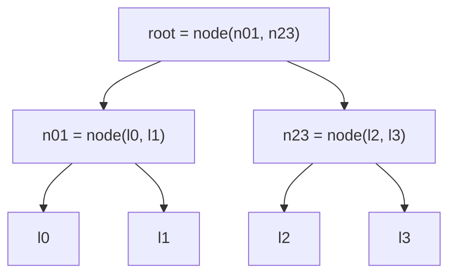

# Hashing

A cryptographic hash function $H: \{0,1\}^{\ast} \to \{0,1\}^{n}$ maps arbitrary-length input to a fixed $n$-bit digest. Deterministic, fast, and, ideally, indistinguishable from a random function.

```ts
import { createHash } from "node:crypto";

const digest = createHash("sha256").update("hello").digest("hex");
// 2cf24dba5fb0a30e26e83b2ac5b9e29e1b161e5c1fa7425e73043362938b9824
```

In proofs we often idealize $H$ as a **random oracle**: a function returning a uniformly random output for each fresh input, consistent on repeats. Real constructions only approximate this.

## Security Properties

For any efficient adversary $\mathcal{A}$, each of these succeeds with only $\text{negl}(n)$ probability:

| property        | game                                                              | generic attack |
| --------------- | ----------------------------------------------------------------- | -------------- |
| preimage        | given $y = H(x)$ for random $x$, output $m$ with $H(m) = y$       | $2^{n}$        |
| second-preimage | given random $m_1$, output $m_2 \neq m_1$ with $H(m_2) = H(m_1)$ | $2^{n}$        |
| collision       | output any $m_1 \neq m_2$ with $H(m_1) = H(m_2)$                 | $2^{n/2}$      |

Implications:

- **Collision $\Rightarrow$ second-preimage.** A second preimage of $m_1$ _is_ a collision $(m_1, m_2)$.
- **Second-preimage $\Rightarrow$ preimage**, but only for compressing $H$: hash a random $m_1$, invert $H(m_1)$; since most outputs have many preimages, you likely get some $m_2 \neq m_1$. Fails for e.g. the identity on $n$ bits, which is collision-free yet trivially invertible.

The collision bound is the [birthday paradox](../math/probability.md#the-birthday-paradox): hash $\sim 2^{n/2}$ random inputs and two will likely match. So a 256-bit hash gives 128-bit collision security, and a 128-bit digest would offer only 64 bits even if unbroken. Pick $n = 2\lambda$ for $\lambda$-bit security.

## Constructions

**Merkle–Damgård** (MD5, SHA-1, SHA-2). Pad $m$ (append `1`, zeros, then $\lvert m \rvert$) and split into blocks $m_1, \ldots, m_k$. Chain a fixed-size compression function $f$ from a constant IV: $h_i = f(h_{i-1}, m_i)$, output $h_k$. If $f$ is collision-resistant, so is $H$. The output _is_ the full internal state, which causes [length extension](#length-extension).

**Sponge** (SHA-3/Keccak). A $b$-bit state split into rate $r$ and capacity $c$. _Absorb_: XOR each $r$-bit block into the state, apply a permutation $f$. _Squeeze_: read $r$ bits, permute, repeat until enough output (so XOFs like SHAKE are free). The $c$ capacity bits are never output, giving $c/2$-bit security and no length extension.

| hash      | output (bits) | construction          | status                                    |
| --------- | ------------- | --------------------- | ----------------------------------------- |
| MD5       | 128           | Merkle–Damgård        | broken: collisions in seconds             |
| SHA-1     | 160           | Merkle–Damgård        | broken: chosen-prefix collisions (2020)   |
| SHA-256   | 256           | Merkle–Damgård        | secure, length-extendable                 |
| SHA-512   | 512           | Merkle–Damgård        | secure, length-extendable, fast on 64-bit |
| SHA3-256  | 256           | sponge (Keccak)       | secure                                    |
| BLAKE2b/s | ≤512 / ≤256   | HAIFA (MD variant)    | secure, fast, built-in keyed mode         |
| BLAKE3    | 256, XOF      | Merkle tree of chunks | secure, parallel, very fast               |

Ethereum's `keccak256` is pre-standard Keccak with different padding; it does **not** equal SHA3-256.

## Length Extension

On a Merkle–Damgård hash, $H(m)$ is the chaining state after the padded $m$. Knowing only $H(m)$ and $\lvert m \rvert$, an attacker resumes from that state and computes

$$
H(m \,\|\, \text{pad}(m) \,\|\, m')
$$

for any $m'$, without knowing $m$. So the naive MAC $t = H(k \,\|\, m)$ is forgeable: from $(m, t)$ get a valid tag on $m \,\|\, \text{pad} \,\|\, m'$.

Fixes:

- **HMAC**: $\operatorname{HMAC}(k, m) = H\bigl((k \oplus \text{opad}) \,\|\, H((k \oplus \text{ipad}) \,\|\, m)\bigr)$. The outer hash hides the inner state.
- **SHA-3 / BLAKE2/3**: no exposed state, so a keyed hash is a fine MAC (KMAC, BLAKE2's key parameter).
- **Truncation**: SHA-512/256 and SHA-384 drop part of the state, so the attacker can't resume.

```ts
import { createHmac, timingSafeEqual } from "node:crypto";

const key = Buffer.from("secret-key");
const tag = createHmac("sha256", key).update("amount=100").digest();

// verify in constant time, never with ===
const ok = timingSafeEqual(tag, createHmac("sha256", key).update("amount=100").digest());
```

## Merkle Trees

Commit to $n$ items with one hash. Hash each item into a leaf, then repeatedly hash pairs into parents until one **root** remains. Any item can be proven to be in the tree with its **inclusion proof**: the $\lceil \log_2 n \rceil$ sibling hashes on the path to the root. The verifier recomputes the path and compares roots.



Proof for $x_2$ is $[l_3, n_{01}]$: compute $\text{node}(\text{node}(\text{leaf}(x_2), l_3), n_{01})$ and compare with the root. Leaves and nodes use the tagged `leafHash` / `nodeHash` from [Domain Separation](#domain-separation) below; without the tags, an internal node passes as a leaf.

```ts
// leafHash, nodeHash: see Domain Separation
type Step = { hash: Buffer; left: boolean };

function root(entries: Buffer[]): Buffer {
  let level = entries.map(leafHash);
  while (level.length > 1) {
    const next: Buffer[] = [];
    for (let i = 0; i < level.length; i += 2) {
      // odd one out is promoted unchanged (RFC 6962 shape)
      next.push(i + 1 < level.length ? nodeHash(level[i], level[i + 1]) : level[i]);
    }
    level = next;
  }
  return level[0];
}

function verify(leaf: Buffer, proof: Step[], root: Buffer): boolean {
  let acc = leafHash(leaf);
  for (const { hash, left } of proof) {
    // `left` says the sibling sits on the left
    acc = left ? nodeHash(hash, acc) : nodeHash(acc, hash);
  }
  return acc.equals(root);
}
```

Edge cases:

- **Odd levels.** Promote the lone node (RFC 6962) rather than duplicating it. Bitcoin duplicates, so lists $[a, b, c]$ and $[a, b, c, c]$ share a root (CVE-2012-2459).
- **Bind the position.** The proof's left/right bits fix the leaf index; also commit to $n$ if "item $i$ of $n$" matters.
- Proof size and verification are $O(\log n)$ hashes; building is $O(n)$.

## Domain Separation

When one hash serves several purposes, an output made for one can pass as an output of another. Fix: bind a distinct **tag** per context into the input, so each use behaves like an independent function.

Classic case is a Merkle tree hashing leaves as $H(x)$ and nodes as $H(L \,\|\, R)$: a leaf $x = L \,\|\, R$ collides with an internal node (second-preimage on the tree). [RFC 6962](https://datatracker.ietf.org/doc/html/rfc6962#section-2.1) tags them:

$$
\text{leaf} = H(\texttt{0x00} \,\|\, x), \qquad \text{node} = H(\texttt{0x01} \,\|\, L \,\|\, R)
$$

```ts
import { createHash } from "node:crypto";

const h = (tag: number, ...parts: Buffer[]) =>
  createHash("sha256")
    .update(Buffer.concat([Buffer.from([tag]), ...parts]))
    .digest();

const leafHash = (entry: Buffer) => h(0x00, entry);
const nodeHash = (l: Buffer, r: Buffer) => h(0x01, l, r);
```

A 1-byte tag is only safe when the rest of the input parses unambiguously; with variable-length fields, length-prefix them or use a unique context string like `"MyProto-v1:leaf"`. Standard primitives bake this in: HKDF's `info`, the `DST` in `hash_to_curve` (RFC 9380), cSHAKE's customization string, TLS 1.3's secret labels.

> If one hash, key, or random oracle is used for more than one thing, separate the domains.
