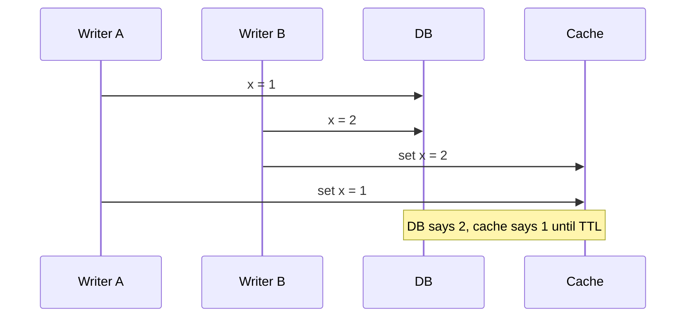

# Caching

A cache keeps a copy of hot data somewhere cheaper to reach than its source of truth. It trades **freshness** for **latency and load**: every cache is a bet that a slightly stale answer now beats a correct answer later. The hard parts are what to store, when to drop it, and what happens when it is empty.

## Where caches live

From the user inward. Each layer absorbs traffic the next one never sees.

| Layer | Example | Typical scope | Invalidation lever |
| --- | --- | --- | --- |
| Client | browser HTTP cache, mobile app memory | one user | `Cache-Control`, `ETag`, versioned URLs |
| CDN | edge PoPs | one region, all users | TTL, purge API, cache keys |
| Reverse proxy | Varnish, nginx `proxy_cache` | one datacenter | TTL, `PURGE`/ban |
| Application | in-process LRU map | one process | TTL, restart |
| Distributed cache | Redis, Memcached | whole service fleet | TTL, explicit `DEL` |
| Database | buffer pool / page cache | one DB node | automatic (LRU-ish over pages) |

In-process caches are the fastest (no network hop, see [numbers](./numbers.md)) but each replica holds its own copy, so they disagree with each other and multiply memory. A distributed cache is one shared copy behind a network hop, sharded the same way as any other store (see [partitioning](./partitioning-replication.md)).

> [!TIP]
>
> If you were designing Netflix, video bytes would be served almost entirely from cache: Open Connect appliances sit inside ISPs and are pre-filled overnight with the titles predicted to be popular, so the origin barely serves playback traffic.

## Strategies

| Strategy | Read path | Write path | Consistency | Latency |
| --- | --- | --- | --- | --- |
| Cache-aside (lazy) | app checks cache, on miss reads DB and fills | app writes DB, then deletes key | stale until delete/TTL; small race window | miss = cache + DB + fill |
| Read-through | cache library loads from DB on miss | (paired with one of the below) | same as cache-aside | same; logic lives in the cache layer |
| Write-through | always hits cache | write cache and DB synchronously | cache never behind DB (if both succeed) | slower writes; caches data that may never be read |
| Write-behind (write-back) | always hits cache | write cache, flush to DB async/batched | DB lags; data loss if cache dies before flush | fastest writes |
| Write-around | cache-aside reads | write DB only, skip cache | next read misses and loads fresh value | good for write-once, read-rarely data |

Cache-aside is the default: the cache is optional, a cache outage degrades to DB load instead of errors, and only data that is actually read gets cached.

```ts
interface Cache {
  get(key: string): Promise<string | undefined>;
  set(key: string, value: string, ttlSec: number): Promise<void>;
  del(key: string): Promise<void>;
}

async function getUser(id: string): Promise<User> {
  const key = `user:${id}`;
  const hit = await cache.get(key);
  if (hit !== undefined) return JSON.parse(hit);

  const user = await db.findUser(id);
  // jitter so keys filled together do not expire together
  const ttl = 300 + Math.floor(Math.random() * 60);
  await cache.set(key, JSON.stringify(user), ttl);
  return user;
}

async function updateUser(user: User): Promise<void> {
  await db.saveUser(user);
  // delete, do not set: the next read reloads from the source of truth
  await cache.del(`user:${user.id}`);
}
```

## Eviction

When memory is full something must go.

- **LRU**: evict the least recently used. Good default for recency-skewed access. Hash map + doubly linked list gives $O(1)$ get/put; see [linked lists](../dsa/linked-lists.md).
- **LFU**: evict the least frequently used. Better when popularity is stable; needs counter decay or old hot keys never leave.
- **FIFO**: evict the oldest insert. Cheap, ignores access pattern; surprisingly competitive with a second-chance bit (CLOCK).
- **TTL**: not a policy for a full cache but an expiry; keys die on time regardless of memory pressure. Usually combined with one of the above.

A full LRU is one big scan-sensitive list: a single sequential scan flushes the working set. Variants (2Q, ARC, W-TinyLFU as used by Caffeine) add a probation segment so one-hit wonders cannot evict hot keys.

Redis does not keep an LRU list: under `allkeys-lru` it samples a few keys (`maxmemory-samples`, default 5) and evicts the oldest-accessed among them, which approximates LRU closely at no per-key list overhead.

## Invalidation

Two levers:

- **TTL**: bounded staleness, zero coordination. The only option when you cannot see writes (third-party data, CDN). Short TTL = fresher but more misses.
- **Explicit delete**: the writer removes the key after committing. Fresh within milliseconds, but every write path must remember to do it. Keep a TTL anyway as a safety net for missed deletes.

**Delete on write beats update on write.** With update, two concurrent writers can apply to the DB in one order and to the cache in the other:



With delete, both writers issue `DEL`; whichever runs last, the key is gone and the next read loads `2`. Deletes are idempotent and order-insensitive; sets are not. Delete also avoids computing values nobody reads.

A smaller race remains: a reader misses, reads the old value, a writer commits and deletes, then the reader fills the cache with the old value. It needs the read to be slower than the write, so it is rare; TTL bounds it, and leases close it.

> [!TIP]
>
> If you were designing Facebook's memcache tier, this is what leases solve: on a miss the cache hands out a token, a `set` is rejected if a delete arrived since the token was issued, and only one token per key is issued every 10 seconds by default, which also tames stampedes.

## Failure modes

### Stampede (thundering herd)

A hot key expires; thousands of requests miss at once and all hit the DB with the same query. Fixes:

- **Request coalescing (single-flight)**: within a process, concurrent misses for one key share one in-flight load. Across processes, use a short lock key (`SET key:lock NX PX 5000`) and let losers wait or serve stale.
- **Probabilistic early refresh**: each read recomputes early with probability rising as expiry nears, e.g. refresh if $t_{now} - \delta \beta \ln(\text{rand}()) \ge t_{expiry}$, where $\delta$ is recompute time and $\beta \approx 1$ (the "XFetch" rule). One request refreshes before the key dies; nobody sees a miss.
- **Jittered TTLs**: add randomness so keys filled together (deploy, warm-up) do not expire together.
- **Serve stale while revalidating**: keep the old value past its soft TTL and refresh in the background (HTTP `stale-while-revalidate`).

```ts
const inflight = new Map<string, Promise<unknown>>();

function singleFlight<T>(key: string, load: () => Promise<T>): Promise<T> {
  const pending = inflight.get(key);
  if (pending) return pending as Promise<T>;

  // clear on settle so a failure is not cached forever
  const p = load().finally(() => inflight.delete(key));
  inflight.set(key, p);
  return p;
}
```

### Hot keys

One key gets so much traffic that its single cache shard saturates (CPU or NIC), no matter how big the cluster is. Fixes: a small in-process cache with a short TTL in front of the distributed one; replicate the key under suffixes (`k#0`..`k#7`) and read a random one; detect hot keys and pin them. Writes to a replicated key must hit every copy.

> [!TIP]
>
> If you were designing Twitter, the home timeline is the classic case: timelines are precomputed into a Redis list per user on write (fan-out), but a celebrity's tweets are not fanned out to millions of followers and are merged in at read time instead.

### Cache penetration

Requests for keys that do not exist miss the cache every time and always reach the DB; an attacker can do this on purpose with random IDs.

- **Negative caching**: cache "not found" (a sentinel) with a short TTL. Remember to delete it when the row is created.
- **Bloom filter** of existing keys in front of the cache: "definitely absent" is answered without touching cache or DB. False positives just fall through; deletes need a counting filter or periodic rebuild.

### Cold start

An empty cache (new cluster, flush, failover) sends 100% of traffic to a DB sized for the miss rate. Fixes: **warm** it before taking traffic (replay recent keys, copy from a warm replica), shift traffic gradually (see [load balancing](./load-balancing.md)), and [rate-limit](./rate-limiting.md) or shed load at the DB until the hit ratio recovers.

## Hit-ratio math

With hit ratio $h$:

$$
t_{\text{eff}} = h \cdot t_{\text{cache}} + (1 - h) \cdot t_{\text{db}}
$$

(For cache-aside a miss really costs $t_{\text{cache}} + t_{\text{db}}$; the difference is small when $t_{\text{cache}} \ll t_{\text{db}}$.)

With $t_{\text{cache}} = 0.5$ ms and $t_{\text{db}} = 10$ ms:

| $h$ | $t_{\text{eff}}$ | DB load (fraction of reads) |
| --- | --- | --- |
| 0.90 | 1.45 ms | 10% |
| 0.99 | 0.60 ms | 1% |
| 0.999 | 0.51 ms | 0.1% |

The last nines barely move latency but cut DB load 10x each. That is the real job of the cache, and why losing it (cold start, stampede) can take the DB down: the DB was sized for $1 - h$, not for all reads.
