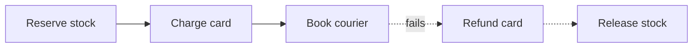

# Consistency & CAP

Two separate questions get mixed up under the word "consistency":

- **Replication consistency**: when copies of one object live on several nodes, what can a reader observe? (CAP, consistency models.)
- **Transaction isolation**: when several operations touching several objects run concurrently, which interleavings are allowed? (ACID's "I".)

Keep them apart: a single-node Postgres has no replication question, and a Dynamo-style KV store with no multi-key transactions has no isolation question.

## CAP

Stated precisely: in an asynchronous network, **when a partition happens**, a replicated register cannot be both **linearizable** (C) and **available** (A: every request to a non-failed node gets a non-error response). You pick one for the duration of the partition.

Common misreadings:

- "Pick 2 of 3." Partitions aren't optional, so the real choice is C or A _during a partition_. "CA" just means "not distributed" or "falls over on partition".
- C in CAP is linearizability, not the C in ACID (invariants hold).
- A in CAP is total: _every_ live node answers. A system that keeps a majority quorum up is "not available" by CAP's definition yet highly available in practice.
- CAP says nothing about latency or the normal no-partition case, which is where systems spend nearly all their time.

## PACELC

The more useful framing: **if Partition, choose A or C; Else, choose Latency or Consistency.** Even with a healthy network, strong consistency costs round trips to a quorum or leader.

| Class | Behaviour | Commonly cited examples |
| ----- | --------- | ----------------------- |
| PA/EL | Stay available on partition, low latency otherwise | Dynamo, Cassandra, Riak (with default low-quorum settings) |
| PC/EC | Refuse/stall on partition, pay latency for consistency | Spanner, etcd/ZooKeeper, CockroachDB, HBase |
| PA/EC | Available on partition, consistent otherwise | MongoDB is often placed here (depends heavily on read/write concern) |

Treat these as defaults, not labels: Cassandra with `QUORUM` reads and writes behaves much closer to PC/EC, and most stores expose per-request knobs. See [quorums](./partitioning-replication.md) for how $R + W > N$ trades latency for overlap.

## Consistency models

Roughly strongest to weakest; each model rules out its anomaly, which every weaker one allows. Read-your-writes and monotonic reads are incomparable with each other.

| Model | Guarantee | Anomaly it rules out |
| ----- | --------- | -------------------- |
| Linearizable | Every op appears to take effect atomically at one instant between its start and end, in real-time order | A write completes, then a later read (from anyone) returns the old value |
| Sequential | One total order consistent with each client's program order, not necessarily real time | Two clients disagree on the order of two writes |
| Causal | Causally related ops are seen in the same order by everyone; concurrent ops may differ | A reply is visible before the comment it replies to |
| Read-your-writes | A client always sees its own earlier writes | You update your profile, refresh, and see the old one |
| Monotonic reads | A client never sees time go backwards | Refresh shows a new comment, next refresh (other replica) hides it |
| Eventual | If writes stop, replicas converge | (no ordering guarantee; only convergence) |

Read-your-writes and monotonic reads are **session guarantees**: per client, cheap to get with sticky routing to one replica or by tracking a version token and only reading from replicas at least that fresh.

## Isolation levels

| Level | Prevents | Still allows |
| ----- | -------- | ------------ |
| Read committed | Dirty reads, dirty writes | Non-repeatable reads, lost updates, write skew |
| Snapshot / repeatable read | Above + non-repeatable reads (each txn reads a consistent snapshot) | Write skew, some phantoms |
| Serializable | All of the above: result equals _some_ serial order | — |

- **Lost update**: two txns read `count = 5`, both write `6`. Fix with `UPDATE ... SET count = count + 1`, `SELECT ... FOR UPDATE`, or compare-and-set.
- **Write skew**: two on-call doctors each check "someone else is on call" under the same snapshot, both go off call. Needs serializable (or explicitly locking the rows the check read).
- Names vary by vendor: Postgres `REPEATABLE READ` is snapshot isolation; Oracle's `SERIALIZABLE` is too. Check what you actually get.
- Serializable ≠ linearizable: serializability is about multi-object transactions with no real-time constraint; linearizability is about single objects in real time. Both together is "strict serializability" (Spanner's pitch).

## Idempotency

Networks retry. A client that times out cannot tell "request lost" from "response lost", so any non-idempotent operation (charge a card, send an email) needs an **idempotency key**: the client generates a unique key per logical operation, and the server stores `key → result` and replays the result on repeat.

The race: two copies of the same request arrive concurrently, both see "key absent", both execute. Claim the key atomically _before_ doing the work.

```ts
type Entry = { status: "pending" } | { status: "done"; result: string };
const store = new Map<string, Entry>();

async function handle(key: string, work: () => Promise<string>): Promise<string> {
  const seen = store.get(key);
  if (seen?.status === "done") return seen.result;
  // a concurrent duplicate is mid-flight: reject, the client retries later
  if (seen?.status === "pending") throw new Error("409 in progress");

  // claim atomically; in a DB this is INSERT ... ON CONFLICT DO NOTHING
  // and checking the affected row count
  store.set(key, { status: "pending" });
  try {
    const result = await work();
    store.set(key, { status: "done", result });
    return result;
  } catch (err) {
    // release the claim so a retry can run the work again
    store.delete(key);
    throw err;
  }
}
```

Pitfalls: store the key in the **same transaction** as the side effect, or a crash between "work done" and "result saved" re-executes it; expire keys (24h is typical); reject a reused key whose request body differs.

> [!TIP]
>
> If you were designing a payments API, this is Stripe's model: clients send an `Idempotency-Key` header, the server saves the first response for that key and returns it on retries, and keys are pruned after about 24 hours.

**"Exactly-once" = at-least-once delivery + idempotent processing (dedup).** No network can deliver exactly once; what systems call exactly-once is retries plus a dedup key or a transactional commit of output and consumer offset together. See [queues & streams](./queues-streams.md).

## Distributed transactions

**Two-phase commit (2PC)**: a coordinator asks every participant to _prepare_ (durably promise it can commit, holding locks), and if all vote yes, tells them to _commit_; any no means abort. It gives atomicity across nodes but is **blocking**: if the coordinator dies after participants voted yes, they sit holding locks until it recovers, since none can decide alone. It also costs extra round trips and fsyncs on the hot path. Fine inside one database (or with a replicated, consensus-backed coordinator, as Spanner does); painful across services.

**Sagas**: split the transaction into local transactions $T_1, \dots, T_n$, each with a **compensation** $C_i$ that semantically undoes it. If $T_k$ fails, run $C_{k-1}, \dots, C_1$.



- No isolation: other txns see intermediate states (stock reserved, card not yet charged). Design for it with "pending" states.
- Compensations must be idempotent and must not fail permanently; retry them.
- Some steps can't be undone (email sent); put them last.
- Orchestration (one coordinator service drives steps) is easier to reason about than choreography (services react to each other's events).

## Clocks

Wall clocks lie for ordering: NTP drift and corrections can jump time backwards, leap seconds happen, and skew between machines is easily milliseconds. "Last write wins" by timestamp then silently drops a write that actually happened later on a machine with a slow clock. Use a monotonic clock for durations and logical clocks for ordering.

**Lamport clock**: a counter per node. If $a \to b$ ($a$ happened-before $b$) then $L(a) < L(b)$. The converse does not hold: $L(a) < L(b)$ does not imply causality (for that, use vector clocks).

```ts
class Lamport {
  t = 0;
  // local event or send: stamp the event / message with the result
  tick(): number {
    return ++this.t;
  }
  // receive: jump past the sender's stamp
  recv(remote: number): number {
    this.t = Math.max(this.t, remote) + 1;
    return this.t;
  }
}
```

Break ties with node id to get a total order `(t, nodeId)`.

> [!TIP]
>
> If you were designing a globally consistent database, Spanner's TrueTime takes the opposite route: it exposes clock uncertainty as an interval (a few ms, kept small by GPS and atomic clocks) and has commits wait out that uncertainty, so timestamp order matches real-time order.
