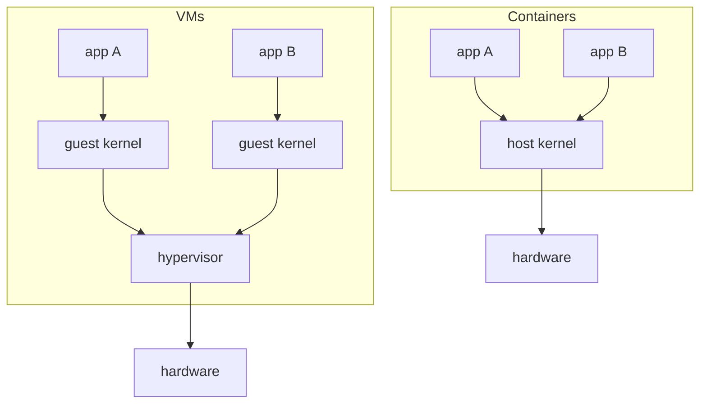
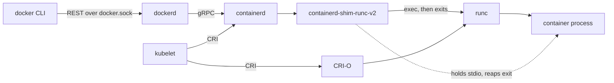

# Containers & Docker

A container is an ordinary Linux process with three things applied: **namespaces** restrict what it can see, **cgroups** limit what it can use, and a separate **root filesystem** gives it its own `/`. The kernel has no "container" object; `ps` on the host shows container processes like any other. Everything Docker adds (images, registries, networking, a CLI) sits around those three primitives. For where containers fit among other isolation options, see [sandboxing](./sandboxing.md).

## Containers vs VMs

|  | Container | VM |
| --- | --- | --- |
| Kernel | shared with the host | its own guest kernel |
| Isolation boundary | syscall interface of the host kernel | hypervisor + virtual hardware |
| Startup | milliseconds (fork + exec) | seconds (boot a kernel), ~100 ms for microVMs |
| Overhead | near zero; no guest OS memory | guest kernel + OS memory per VM |
| Runs a different OS | no (Linux on Linux only) | yes |
| Escape surface | every syscall the kernel exposes | hypervisor and device emulation |



[microVMs](./microvms.md) (Firecracker, gVisor's user-space kernel) sit in between: VM-grade boundaries with near-container startup.

## Namespaces

Each namespace type gives the process a private view of one kernel resource. `clone(2)` / `unshare(2)` create them; `setns(2)` joins an existing one (this is how `docker exec` works). See them under `/proc/<pid>/ns/`.

| Namespace | Isolates | Effect inside the container |
| --- | --- | --- |
| `pid` | process ID numbers | app is PID 1; cannot see or signal host processes |
| `mnt` | mount table | own `/`, own mounts; host mounts invisible |
| `net` | interfaces, routes, iptables, sockets | own `lo` and `eth0`, own ports |
| `uts` | hostname, domain name | `hostname` changes do not leak |
| `ipc` | System V IPC, POSIX message queues | no shared memory with host processes |
| `user` | UID/GID mappings, capabilities | root inside maps to an unprivileged UID outside |
| `cgroup` | view of the cgroup tree | sees its own cgroup as `/` |
| `time` | `CLOCK_MONOTONIC` / `CLOCK_BOOTTIME` offsets | uptime can differ; wall clock is still shared |

**User namespaces** are what make rootless containers possible: `/proc/<pid>/uid_map` maps, say, container UID 0 to host UID 100000 (ranges come from `/etc/subuid`). The process has full capabilities over resources owned by its namespace, but outside it is just UID 100000. Docker does not enable this by default (`userns-remap` is opt-in); Podman rootless does.

Note what is **not** namespaced: the kernel itself, kernel modules, most of `/sys`, the system clock, kernel keyrings (partially), and device drivers.

## cgroups v2

cgroups form a single hierarchy under `/sys/fs/cgroup`. Each directory is a group; writing a PID into `cgroup.procs` moves it there; controllers are enabled for children via the parent's `cgroup.subtree_control`.

| Controller | File | Meaning |
| --- | --- | --- |
| memory | `memory.max` | hard limit; exceeding it after reclaim triggers the OOM killer in the group |
| memory | `memory.high` | soft limit; above it the group is throttled and reclaimed aggressively |
| memory | `memory.swap.max` | swap allowed on top of `memory.max` |
| cpu | `cpu.max` | `"$QUOTA $PERIOD"` in µs, e.g. `"150000 100000"` = 1.5 CPUs |
| cpu | `cpu.weight` | relative share under contention (1–10000, default 100) |
| pids | `pids.max` | max tasks; stops fork bombs |
| io | `io.max` | per-device `rbps`/`wbps`/`riops`/`wiops` caps |

How `docker run` flags land (with the systemd cgroup driver the group is `/sys/fs/cgroup/system.slice/docker-<id>.scope/`):

| Flag | cgroup file |
| --- | --- |
| `--memory 512m` | `memory.max = 536870912` |
| `--memory-swap 1g` | `memory.swap.max = 536870912` (Docker's value is memory + swap; v2 stores swap alone) |
| `--cpus 1.5` | `cpu.max = 150000 100000` |
| `--cpu-shares` | `cpu.weight` (converted from the v1 1024 scale) |
| `--pids-limit 100` | `pids.max = 100` |
| `--device-read-bps /dev/sda:10mb` | `io.max` |

**OOM**: when the group cannot reclaim below `memory.max`, the kernel kills a process inside that group (not elsewhere on the host). The container exits with `137` (128 + SIGKILL), `docker inspect` shows `OOMKilled: true`, and `memory.events` counts `oom_kill`. CPU limits never kill; exceeding `cpu.max` just throttles (`cpu.stat` → `nr_throttled`), which shows up as tail latency.

## Filesystem: layers and overlayfs

An image is a stack of read-only layers; a container adds one thin writable layer on top. overlayfs merges them into one view:

```sh
# lowerdir: read-only layers, leftmost is the top
# upperdir: the container's writable layer
# workdir: scratch space overlayfs needs on the same fs as upperdir
mount -t overlay overlay \
  -o lowerdir=/l/app:/l/deps:/l/base,upperdir=/c/upper,workdir=/c/work \
  /c/merged
```

- Reads fall through from upper to the first lower layer that has the file.
- First write to a lower file triggers **copy-up**: the whole file is copied into upperdir, then modified. Writing 1 byte to a 2 GB file in an image copies 2 GB. Put hot-write data on volumes, which bypass overlayfs.
- Deletes create a **whiteout** (a 0/0 character device) in upperdir that hides the lower file. The bytes stay in the lower layer, which is why `RUN rm` in a later layer does not shrink an image.

Layers are shared: ten containers from one image share the lower layers on disk and in the page cache, and a pull only downloads layers whose digest is not already present.

**chroot vs pivot_root**: `chroot` only changes where path lookup starts for one process; the old root stays mounted and a process with `CAP_SYS_CHROOT` can break out (chroot into a subdir, then `cd ..` past it). `pivot_root` swaps the root mount of the whole mount namespace and lets you unmount the old root entirely, so there is nothing left to escape to. Runtimes use `pivot_root`.

## Images

An [OCI image](https://github.com/opencontainers/image-spec) is content-addressed blobs:

- **Manifest**: JSON listing the config digest and the ordered layer digests. A multi-arch tag points at an **index** of per-platform manifests.
- **Config**: entrypoint, env, user, working dir, plus `diff_ids` (digests of the uncompressed layers).
- **Layers**: tarballs (usually gzip or zstd compressed) of filesystem changes, each named by its `sha256`.

A **registry** is an HTTP API serving blobs and manifests by digest. A **tag** (`alpine:3.20`) is a mutable pointer to a manifest; a **digest** (`alpine@sha256:…`) is immutable. Pin digests in production and CI so a re-pushed tag cannot change what you run.

**Build caching**: each Dockerfile instruction produces a layer cached by (parent layer, instruction, and for `COPY`/`ADD` the file contents). The first cache miss invalidates every later step, so order from least to most frequently changing:

```dockerfile
# build stage: full toolchain, discarded later
FROM node:22 AS build
WORKDIR /app
# manifests first: this layer only rebuilds when dependencies change
COPY package.json package-lock.json ./
RUN npm ci
# source last: edits here reuse the cached npm ci layer
COPY . .
RUN npm run build

# runtime stage: only the output, no compiler or dev deps
FROM node:22-slim
WORKDIR /app
COPY --from=build /app/dist ./dist
COPY --from=build /app/node_modules ./node_modules
USER node
CMD ["node", "dist/index.js"]
```

`COPY . .` before `npm ci` would reinstall dependencies on every source edit. **Multi-stage** builds keep compilers, caches, and secrets used during the build out of the shipped image; only what `COPY --from` pulls across survives.

## The stack



- **dockerd**: images, builds (BuildKit), networks, volumes, the API.
- **containerd**: container lifecycle, image pull/unpack, snapshots. Usable without Docker.
- **shim**: one per container; keeps it alive and its stdio open, so dockerd and containerd can restart without killing containers.
- **runc**: the reference [OCI runtime](https://github.com/opencontainers/runtime-spec). It reads a bundle (`config.json` + `rootfs/`), sets up namespaces, cgroups, mounts, capabilities, and seccomp, `exec`s the entrypoint, and exits. `crun` (C) and `runsc` (gVisor) are drop-in alternatives.

**Podman** is daemonless: the CLI forks the runtime directly (with `conmon` as the per-container monitor), so there is no root daemon socket. **Kubernetes** dropped Docker (dockershim removed in 1.24) and talks CRI to containerd or CRI-O directly; images are the same OCI artifacts.

## Networking

Default `bridge` mode:

1. A **veth pair** is created; one end becomes `eth0` in the container's net namespace, the other attaches to the `docker0` bridge on the host (default subnet `172.17.0.0/16`).
2. **Egress**: a `MASQUERADE` rule NATs container traffic to the host's IP.
3. **Port publishing** (`-p 8080:80`): a `DNAT` rule in the `DOCKER` chain rewrites host port 8080 to the container's IP:80 (plus a userland `docker-proxy` for some paths). Newer releases can use nftables instead of iptables.

Published ports are inserted ahead of typical host firewall rules (e.g. `ufw`), so `-p 8080:80` can be reachable from the internet even when the firewall "blocks" 8080. Bind to `127.0.0.1:8080:80` when you mean local only. Other modes: `--network host` (share the host net namespace, no isolation), `--network none` (only `lo`; good for untrusted batch jobs).

## Build a container by hand

Linux only; needs root (or a user namespace plus delegated cgroups). Illustration, not hardening.

```sh
# root filesystem: Alpine's minirootfs tarball
mkdir rootfs
curl -L https://dl-cdn.alpinelinux.org/alpine/v3.20/releases/x86_64/alpine-minirootfs-3.20.3-x86_64.tar.gz | tar -xz -C rootfs

# limits: a leaf cgroup, then move this shell into it (children inherit)
sudo mkdir /sys/fs/cgroup/demo
echo 100M | sudo tee /sys/fs/cgroup/demo/memory.max
echo "50000 100000" | sudo tee /sys/fs/cgroup/demo/cpu.max
echo 64 | sudo tee /sys/fs/cgroup/demo/pids.max
echo $$ | sudo tee /sys/fs/cgroup/demo/cgroup.procs

# views: new pid/mount/net/uts/ipc/cgroup namespaces, fresh /proc inside rootfs, then chroot
sudo unshare --pid --fork --mount --net --uts --ipc --cgroup \
  --mount-proc="$PWD/rootfs/proc" \
  chroot rootfs /bin/sh
```

Inside: `ps` shows only `sh` as PID 1, `ip link` shows only a down `lo`, `hostname box` does not touch the host. Swap `chroot` for `pivot_root` to make it escape-proof:

```sh
# inside the new mount namespace (unshare defaults to private propagation)
# pivot_root needs the new root to be a mount point
mount --bind rootfs rootfs
cd rootfs
mkdir -p .old
pivot_root . .old
cd /
# detach the host's root so nothing outside is reachable
umount -l /.old
```

What is still missing compared with runc: dropped capabilities, a seccomp filter, a user namespace, read-only `/proc/sys`, masked paths, and a veth for networking.

## Security notes

- **The shared kernel is the escape surface.** Any kernel bug reachable by a syscall the container is allowed to make (Dirty COW, Dirty Pipe) is a host compromise. Namespaces are a visibility feature, not a security boundary on their own.
- **Root in the container is root on the host** unless a user namespace remaps it. It is constrained only by capabilities, seccomp, and LSMs (AppArmor/SELinux). Run as a non-root `USER` anyway.
- **Capabilities**: Docker keeps a small default set (`CHOWN`, `NET_BIND_SERVICE`, `SETUID`, `KILL`, …) and drops the dangerous ones (`SYS_ADMIN`, `NET_ADMIN`, `SYS_MODULE`, `SYS_PTRACE`). `--cap-drop ALL` then add back what you need.
- **seccomp**: the default profile is an allowlist that blocks a few dozen syscalls (`kexec_load`, `mount`, `bpf`, `keyctl`, and `unshare` unless the container has `CAP_SYS_ADMIN`), cutting a large part of the kernel attack surface for free. `--security-opt seccomp=unconfined` throws that away.
- **`--privileged`** gives all capabilities, all devices, no seccomp, no AppArmor: effectively root on the host (mount the host disk, load a kernel module).
- **Mounting `/var/run/docker.sock`** into a container gives it the Docker API, which can start a `--privileged` container with `/` bind-mounted. It is root on the host, whatever the container's own user.

See [sandboxing](./sandboxing.md) for layering gVisor, microVMs, and seccomp/LSM policies on top.

> [!TIP]
>
> If you were designing a CI system that runs untrusted pull requests, plain containers on a shared host are the weak point: one kernel exploit reaches every other tenant's secrets. Hosted runners on major CI providers generally use a fresh VM per job; a cheaper middle ground is a [microVM](./microvms.md) or gVisor per job, no docker.sock mount (use rootless BuildKit or similar for image builds), and `--network none` or an egress allowlist.

> [!TIP]
>
> If you were designing a PaaS running many tenants (Heroku-, Fly-style), the choice is density vs isolation. Heroku dynos were historically LXC-style containers; Fly.io runs each app instance in a Firecracker microVM. Either way, cgroup limits (memory, `pids.max`, `cpu.max`) keep one noisy tenant from starving its neighbours, and per-tenant user namespaces stop "root in one container" from being the same UID as root in another.

## macOS and Windows

Containers need a Linux kernel. Docker Desktop, OrbStack, Colima, and Podman machine run a lightweight Linux VM and forward the CLI socket, ports, and file shares into it. Bind mounts cross the VM boundary, which is why file-heavy workloads (`node_modules`, big builds) are slower than on native Linux. Windows also has native Windows containers (Windows kernel), a separate image ecosystem.
