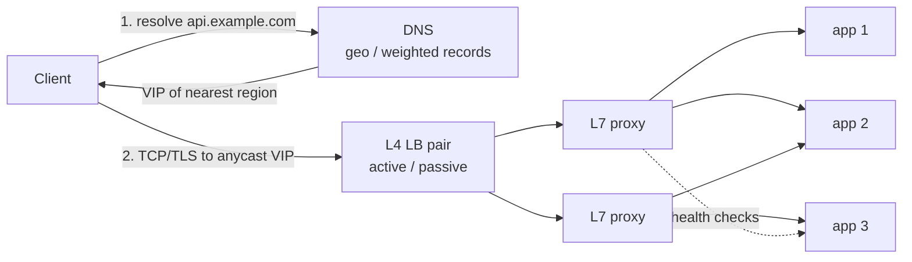

# Load Balancing

A load balancer spreads requests over a pool of interchangeable backends so that no single one saturates, and routes around the ones that are down. Two decisions matter: **at which layer** it looks at traffic (L4 packets vs L7 requests) and **which algorithm** picks the backend. Everything else is health checking and failure handling.

## L4 vs L7

|                 | L4 (transport)                                          | L7 (application)                                                       |
| --------------- | ------------------------------------------------------- | ---------------------------------------------------------------------- |
| Sees            | IPs, ports, TCP/UDP flow                                | HTTP method, path, headers, cookies, gRPC service/method               |
| Unit of balance | connection (flow)                                       | request (can split one connection's requests across backends)          |
| TLS             | passes through (no termination needed)                  | terminates TLS to read the request; may re-encrypt to backends         |
| Can do          | NAT / direct server return, very high pps               | path/host routing, header rewrite, retries, auth, caching, compression |
| Cost            | cheap: per-packet work, little state, often in kernel   | expensive: parse every request, hold TLS state and buffers             |
| Examples        | AWS NLB, Maglev, IPVS, HAProxy `mode tcp`               | AWS ALB, Envoy, Nginx, HAProxy `mode http`                             |

A common stack is both: an L4 tier spreads connections over a fleet of L7 proxies, which do the request-aware routing.

## Algorithms

| Algorithm                | How                                                        | Good for / caveat                                                    |
| ------------------------ | ---------------------------------------------------------- | -------------------------------------------------------------------- |
| Round robin              | cycle through backends                                     | uniform backends and requests; ignores actual load                   |
| Weighted round robin     | backend $i$ gets $w_i / \sum w$ of traffic                 | mixed instance sizes, canaries (send 1% to the new version)          |
| Least connections        | fewest open connections / in-flight requests               | variable request cost; needs a global view of counts                 |
| Least response time      | lowest (latency × in-flight), e.g. EWMA of latency         | heterogeneous or degraded backends; latency signal is noisy          |
| Random                   | uniform pick                                               | stateless, trivial; load variance grows with traffic                 |
| Power of two choices     | sample 2 at random, pick the less loaded                   | near-least-connections quality with no global state; the default pick |
| IP hash / consistent hash| hash(client IP or key) → backend                           | sticky routing, cache affinity; uneven if keys are skewed            |

**Power of two choices.** With $n$ balls into $n$ bins, uniform random gives a max load of $\Theta(\log n / \log\log n)$; letting each ball pick the lighter of two random bins drops it to $\log_2 \log n + O(1)$. Intuition: one extra sample almost never lands you on the worst bin twice, so overloaded backends stop receiving traffic. It also degrades gracefully with **stale load info**: pure least-connections makes every balancer pile onto the same "least loaded" backend (herding), while random sampling spreads that error.

```ts
type Backend = { id: string; inflight: number };

// pick two distinct backends at random, route to the less loaded one
function pickP2C(backends: Backend[]): Backend {
  const n = backends.length;
  if (n === 1) return backends[0];
  const i = Math.floor(Math.random() * n);
  // offset in [1, n-1] guarantees j !== i
  const j = (i + 1 + Math.floor(Math.random() * (n - 1))) % n;
  const a = backends[i];
  const b = backends[j];
  return a.inflight <= b.inflight ? a : b;
}
```

In a simulation of $10^5$ never-finishing requests over 100 backends, the busiest backend sits ~120 above the mean with random picks and ~2 above it with P2C.

> [!TIP]
> Twitter's Finagle RPC library and Envoy both ship P2C variants (least-loaded, or peak-EWMA latency) as their client-side balancers, and Nginx exposes it as `random two least_conn`.

**Hashing for stickiness.** `hash(key) % n` remaps almost every key when $n$ changes; consistent hashing (ring or rendezvous) remaps only ~$1/n$, which matters when backends hold per-key state like a cache. See [consistent hashing](./partitioning-replication.md). Hash on a stable key (user ID, session ID) rather than client IP: NAT and mobile networks put many users behind one IP and move one user across IPs.

## Health checks

- **Active**: the LB probes each backend (`GET /healthz`, TCP connect) every few seconds; mark down after $k$ consecutive failures, up after $m$ successes. Catches dead hosts with no traffic, but a shallow probe can pass while real requests fail.
- **Passive**: watch real traffic (5xx rate, timeouts, connection resets). Reflects what users see, but needs traffic to detect anything.
- **Outlier ejection**: passive checks turned into action. Eject a backend for a backoff period after e.g. 5 consecutive 5xx, or when its error rate is far above the pool's; cap the ejected fraction (e.g. ≤ 50%) so a pool-wide problem doesn't eject everyone and dump all load on the survivors.

Keep `/healthz` cheap and local. If it checks the shared database, a DB blip marks every backend unhealthy at once and the LB has nowhere to send traffic.

## Connection draining

To remove a backend (deploy, scale-in), stop sending it **new** connections/requests, let in-flight ones finish up to a timeout (e.g. 30 s), then kill it. The app's side: on `SIGTERM`, fail the health check, keep serving, close idle keep-alive connections, and exit when done. Without draining, every deploy shows up as a spike of 502s/resets.

## Where balancing happens



- **DNS**: return different IPs per client (round robin, geo, latency-based). Coarse and slow to react: resolvers and clients cache past the TTL, some ignore low TTLs, and DNS has no idea about backend load. Good for picking a region, not a server.
- **Anycast / BGP**: many sites announce the same IP prefix; routers send each packet to the topologically nearest one. Failover happens when a site withdraws its route. Works naturally for UDP (DNS); for TCP, a route change mid-connection can land packets on a site with no state for that flow.
- **Dedicated LB**: hardware appliances (F5) or software (HAProxy, Envoy, Nginx) on a VIP. Central place for TLS, routing rules, and metrics; an extra hop and a component that must itself be redundant.
- **Client-side**: the client gets the backend list from service discovery and picks itself. gRPC does this with its `round_robin` / `pick_first` policies (or xDS); a service mesh puts an Envoy sidecar next to each service. No extra hop and no central bottleneck, but every client needs the logic and a fresh view of the pool.

> [!TIP]
> Google's Maglev is the canonical software L4 balancer: routers ECMP packets across a fleet of Maglev machines, each of which uses consistent hashing on the 5-tuple so any machine sends a given connection to the same backend.

## Pitfalls

- **Sticky sessions**: pinning a user to a backend (cookie or hash) because the session lives in memory. Load becomes uneven, a dead backend logs everyone on it out, and draining takes as long as the longest session. Prefer stateless app servers with sessions in a shared store (see [caching](./caching.md)); use stickiness only as a cache-affinity optimization that may fail.
- **Long-lived connections (WebSockets, gRPC streams, HTTP/2)**: an L4 or per-connection balancer only balances at connect time. After a scale-out the new backends sit idle while old ones hold all the connections; after a restart all clients reconnect at once. Balance per request at L7 for HTTP/2/gRPC, cap connection lifetime (`max_connection_age`) so clients periodically rebalance, and add jitter to reconnects.
- **Retry storms**: at 3 retries per layer, 3 layers deep, one user request can become $4^3 = 64$ backend calls exactly when the backend is overloaded. Retry at one layer only, with exponential backoff and jitter, and use a retry budget (e.g. retries ≤ 10% of requests) plus circuit breakers. See [rate limiting](./rate-limiting.md).
- **The LB as a single point of failure**: run LBs in pairs. Active-passive: both share a floating VIP via VRRP (keepalived); the standby takes the VIP when heartbeats stop, dropping in-flight connections unless state is synced. Active-active: several LBs behind DNS, anycast, or ECMP. Size so that the survivors can carry the full load after one fails.

> [!TIP]
> If you were designing a chat gateway like Discord's, clients hold one WebSocket each; the gateway asks clients to reconnect (Discord's opcode 7 `Reconnect`) when it wants to shed or move them, rather than relying on the LB to rebalance.
