# gVisor, MicroVMs & Wasm

[Containers](./containers.md) isolate with namespaces and cgroups, but every container still makes syscalls straight into the **one shared host kernel**. That is fine for code you wrote. For hostile code (customer functions, plugins, LLM-generated scripts) you want a boundary that does not depend on the host kernel being bug-free. The options trade compatibility and overhead for a smaller attack surface; see [sandboxing](./sandboxing.md) for the overview.

## Why containers are not enough

- **Shared kernel**: Linux exposes a few hundred syscalls (roughly 300–450 depending on architecture), plus ioctls, `/proc`, `/sys`, netlink, eBPF, and filesystem drivers. All of it is reachable from inside a container unless filtered.
- **Kernel CVE = escape**: a container boundary is only as strong as the kernel. Bugs like Dirty COW (2016) and Dirty Pipe (2022) let unprivileged processes write to read-only files, and container escapes followed.
- **Hardening helps but does not change the model**: seccomp allowlists, dropped capabilities, user namespaces, and AppArmor/SELinux shrink the surface, but the remaining syscalls still run in the host kernel.

The stronger options move the boundary: put a second kernel in front of the host (gVisor), give each tenant its own kernel behind hardware virtualization (microVMs), or never give the guest syscalls at all (Wasm, isolates).

```mermaid
flowchart TB
  subgraph C[Container]
    A1[app] -->|syscall| K1[host kernel]
  end
  subgraph G[gVisor]
    A2[app] -->|syscall| S2[Sentry, user-space kernel in Go]
    S2 -->|small seccomp-filtered set| K2[host kernel]
  end
  subgraph M[MicroVM]
    A3[app] -->|syscall| GK3[guest kernel]
    GK3 -->|virtio, VM exits| V3[VMM, e.g. Firecracker]
    V3 -->|seccomp-filtered| K3[host kernel]
  end
  subgraph W[Wasm]
    A4[guest module] -->|only imported functions| H4[host runtime]
    H4 --> K4[host kernel]
  end
```



## gVisor

An application kernel written in Go that sits between the app and the host.

- **Sentry**: a user-space process that implements the Linux syscall ABI itself (its own VFS, network stack via netstack, signals, memory management). The app's syscalls land in the Sentry, not the host.
- **Platforms** decide how syscalls get intercepted: `ptrace` (portable, slow), `KVM` (uses virtualization hardware for address-space switching), and `systrap` (seccomp `SIGSYS` trapping; the default since 2023).
- **Gofer**: a separate process that does file access on the Sentry's behalf, so the Sentry itself can run with almost no host file access. Newer versions can use a directfs mode where the Sentry opens files directly from donated FDs.
- The Sentry itself talks to the host through a small seccomp-filtered set of syscalls, so a bug in the app-facing syscall implementation lands in a memory-safe user-space process, not ring 0.

`runsc` is an OCI runtime, so it drops into Docker or containerd in place of `runc`:

```sh
# register once in /etc/docker/daemon.json: {"runtimes": {"runsc": {"path": "/usr/local/bin/runsc"}}}
docker run --rm --runtime=runsc alpine uname -a
# inside: dmesg shows gVisor's fake boot log, not the host's
docker run --rm --runtime=runsc alpine dmesg
```

Trade-offs:

- **Syscall-heavy and IO-heavy workloads are slower**: every syscall pays an interception plus a Go implementation; file IO may cross to the Gofer. CPU-bound code runs near native.
- **Compatibility gaps**: not every syscall, ioctl, `/proc` file, or socket option is implemented. Most web stacks work; exotic tooling, some kernel-facing software, and GPU workloads need checking.
- No guest kernel to boot, so startup is close to a container's.

Used by Google Cloud Run (first-generation environment), App Engine, and Cloud Functions.

## MicroVMs

A real VM per tenant, but stripped down. KVM gives hardware-enforced memory isolation; the **virtual machine monitor (VMM)** emulates only the handful of devices a server workload needs, so there is far less emulator code to attack than in QEMU.

**Firecracker** (AWS, Rust):

- Devices: virtio-net, virtio-block, virtio-vsock, a serial console, and a minimal keyboard controller for shutdown. No PCI (historically), no BIOS, no USB, no graphics; it boots a Linux kernel directly.
- Published figures: on the order of 125 ms to a running userspace and under 5 MiB of VMM memory overhead per VM, with thousands of microVMs per host. Treat as best-case design targets; your kernel and rootfs dominate real boot time.
- Powers AWS Lambda and Fargate; also used by Fly.io and others.
- **Snapshot/restore**: pause a booted, warmed-up VM, write memory and device state to disk, and later restore it, memory mapped lazily from the snapshot file. Restore is reported in the low milliseconds to tens of ms. Pitfall: every restored clone shares the same RNG state, entropy pools, and in-memory secrets, so reseed (VM generation ID / `vmgenid`) after restore.
- **Jailer**: a wrapper that starts each Firecracker process in its own chroot, namespaces, cgroup, and unprivileged uid, then applies seccomp. Defense in depth: a VMM escape lands in a jailed process, not on the host.

Other VMMs and runtimes:

- **Kata Containers**: an OCI runtime (`kata-runtime` / containerd shim) that runs each pod inside a lightweight VM, backed by QEMU, Cloud Hypervisor, or Firecracker.
- **Cloud Hypervisor**: a Rust VMM from the same rust-vmm crate family as Firecracker, aimed at general cloud workloads (more devices, hotplug, VFIO passthrough).

Costs: a guest kernel per tenant (memory, boot time), nested virtualization needed if you run inside a cloud VM, and harder resource sharing (no page cache sharing across VMs by default).

> [!TIP]
>
> If you were designing a serverless platform like Lambda, the published Firecracker design is the reference: one microVM per function sandbox (never shared across customers), many per bare-metal host, the jailer around every VMM, and snapshots of an initialized runtime (as in Lambda SnapStart) to hide cold-start cost.

## Wasm and language isolates

Skip the kernel entirely: the guest is bytecode that can only call what the host hands it.

- **Linear memory**: a Wasm instance sees one bounds-checked byte array. It cannot form pointers into the host or into other instances.
- **No ambient authority**: a module has no syscalls. Every effect (log, read a file, open a socket) is an **import** the host must supply at instantiation.
- **WASI** standardizes those imports as capabilities: the runtime preopens specific directories (`wasmtime run --dir ./data app.wasm`) and the guest can only resolve paths under them.
- **Fast start**: instantiating a precompiled module takes microseconds to a few milliseconds, with memory overhead in KBs to MBs.
- **Runtimes**: Wasmtime (Bytecode Alliance, Cranelift JIT), Wasmer, WasmEdge (CNCF, edge/IoT focus). Browsers and Node run Wasm in V8.

"No imports = no capabilities", in Node:

```ts
// (module (import "env" "log" (func (param i32))) (func (export "run") i32.const 42 call 0))
const bytes = new Uint8Array([
  0x00, 0x61, 0x73, 0x6d, 0x01, 0x00, 0x00, 0x00,
  // type section: (i32) -> () and () -> ()
  0x01, 0x08, 0x02, 0x60, 0x01, 0x7f, 0x00, 0x60, 0x00, 0x00,
  // import section: env.log, type 0
  0x02, 0x0b, 0x01, 0x03, 0x65, 0x6e, 0x76, 0x03, 0x6c, 0x6f, 0x67, 0x00, 0x00,
  // function section: one function of type 1
  0x03, 0x02, 0x01, 0x01,
  // export section: "run" = function 1
  0x07, 0x07, 0x01, 0x03, 0x72, 0x75, 0x6e, 0x00, 0x01,
  // code section: i32.const 42; call 0; end
  0x0a, 0x08, 0x01, 0x06, 0x00, 0x41, 0x2a, 0x10, 0x00, 0x0b,
]);

const mod = new WebAssembly.Module(bytes);
// the module declares exactly what it needs: [{ module: "env", name: "log", kind: "function" }]
console.log(WebAssembly.Module.imports(mod));

try {
  // no imports: instantiation throws, the guest cannot reach anything
  new WebAssembly.Instance(mod, {});
} catch (e) {
  console.log("denied:", (e as Error).name);
}

// grant one capability: a logging function, nothing else
const { exports } = new WebAssembly.Instance(mod, {
  env: { log: (x: number) => console.log("guest says", x) },
});
// prints "guest says 42"
(exports.run as () => void)();
```

Limits:

- You must **compile to Wasm**: fine for Rust, C/C++, Go (TinyGo or `GOOS=wasip1`), AssemblyScript; dynamic languages ship their interpreter as a Wasm module, which costs size and speed.
- **Threads, sockets, and async IO are still maturing** (WASI preview 2 / component model, `wasi-sockets`, threads proposals); support varies by runtime.
- The isolation is only as good as the runtime's JIT and your host functions. A host import that takes a path or URL from the guest is a capability you must validate.

**V8 isolates** (Cloudflare Workers, Deno Deploy, Vercel Edge Functions) apply the same idea to JavaScript: each tenant gets its own isolate (separate heap, no shared objects), and many tenants share one OS process. Startup is a few ms and per-tenant memory is small, so one machine can host thousands of tenants.

The catch is **Spectre**: tenants in one address space can, in principle, read each other's memory through speculative-execution side channels. Publicly described mitigations (Cloudflare's, at least) include:

- **No precise timers**: `Date.now()` does not advance during execution, and there is no shared-memory concurrency to build a timer from.
- **Process isolation for risky tenants**: suspicious workers are moved to separate processes; plus OS-level sandboxing (seccomp, namespaces) around the runtime as a second layer.
- Fast V8 patching and dynamic process isolation as new attacks appear.

Browsers took the other route: Chrome's Site Isolation puts each site in its own process, because in-process isolation alone was judged insufficient against Spectre.

> [!TIP]
>
> If you were designing an edge-functions platform, isolates are the published Cloudflare Workers answer: cold starts in milliseconds and thousands of tenants per process make running every customer in every PoP affordable, at the price of JS/Wasm only, tight CPU and memory limits, and a Spectre defense you have to own.

## Choosing

| Workload | Recommended isolation | Why |
| --- | --- | --- |
| Trusted microservices (your own code) | containers (+ seccomp, non-root) | lowest overhead; the threat is bugs, not attackers |
| Multi-tenant untrusted code, full Linux needed | microVM (Firecracker, Kata) or gVisor | hardware boundary or a second kernel between tenant and host |
| Short plugins, UDFs, request handlers | Wasm or V8 isolates | µs–ms starts, capability-based, tiny per-tenant cost |
| AI agent tool execution / code interpreter | microVM or gVisor per session, snapshotted | arbitrary binaries and `pip install` need real Linux; snapshots make per-session VMs cheap |
| CI runners for public PRs | microVM or ephemeral VM per job | untrusted build scripts with root inside the job |

Rule of thumb: if the guest needs arbitrary Linux binaries, it is microVM vs gVisor (microVM for stronger isolation and compatibility, gVisor for density and no nested virtualization). If you control the language, Wasm/isolates are far cheaper per tenant.

> [!TIP]
>
> If you were designing an AI code interpreter, give each session its own microVM or gVisor sandbox restored from a snapshot with the language runtime and common packages preloaded, network egress off or allowlisted, CPU/memory/time caps, and the VM destroyed at session end. Several public sandbox services (E2B, for example) document building on Firecracker for this; gVisor is the documented basis of others.

## Pitfalls

- **The boundary is not the whole sandbox**: metadata endpoints (`169.254.169.254`), mounted credentials, and open egress let a perfectly isolated guest still exfiltrate or pivot. Lock down network and secrets regardless of runtime.
- **Snapshots clone secrets and randomness**: never bake per-tenant keys into a shared snapshot; reseed RNGs after restore.
- **Side channels survive VMs too**: microVMs on shared cores are still exposed to cache and speculative attacks; high-assurance setups pin tenants to cores or disable SMT.
- **Resource exhaustion is a separate problem**: isolation stops reading your memory, not burning your CPU. Keep cgroup limits, timeouts, and per-tenant quotas.
