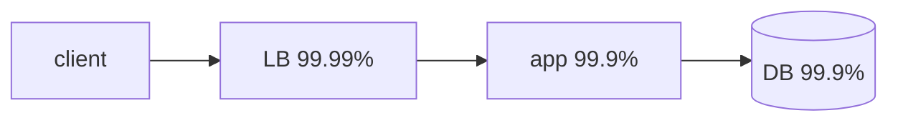

# Numbers to Know

System design starts with arithmetic: which component is the bottleneck, does the hot set fit in memory, how many machines. You need the orders of magnitude, not exact figures. Every number below is **approximate**. Hardware changes the constants, but the ratios between rows stay roughly the same. [Complexities](../dsa/complexities.md) is the same idea for algorithms.

## Latency

The classic "latency numbers every programmer should know" (Jeff Dean, Peter Norvig), rounded and updated for current hardware:

| Operation                            | Latency          | Relative to memory |
| ------------------------------------ | ---------------- | ------------------ |
| L1 cache reference                   | ~1 ns            | 1/100              |
| L2 cache reference                   | ~4 ns            | 1/25               |
| Main memory reference                | ~100 ns          | 1                  |
| SSD random read (4 KB)               | ~20–100 µs       | ~500×              |
| Read 1 MB sequentially from memory   | ~10–50 µs        |                    |
| Read 1 MB sequentially from SSD      | ~0.2–1 ms        |                    |
| Read 1 MB sequentially from HDD      | ~5–20 ms         |                    |
| HDD seek                             | ~10 ms           | 100,000×           |
| Round trip within a datacenter       | ~0.5 ms          | 5,000×             |
| Round trip across regions (US↔EU)    | ~70–150 ms       | ~1,000,000×        |

What follows from the table:

- Memory is about 1000× faster than a network hop, and a network hop is about 100× faster than a cross-region hop. Count the hops on the request path first.
- Sequential reads beat random reads by orders of magnitude on every medium. That is why logs, LSM trees and Kafka are append-only.
- Light in fiber covers about 200 km/ms. No protocol gets a cross-ocean round trip under ~60–80 ms, so a strongly consistent write across regions costs at least that much (see [Consistency](./consistency.md)).

## Throughput rules of thumb

Order-of-magnitude figures for one well-provisioned node with simple operations. Real numbers depend on payload size, query shape, durability settings and hardware, so benchmark before you commit.

| Component                     | Rough capacity                                       |
| ----------------------------- | ---------------------------------------------------- |
| Postgres / MySQL node         | ~10k–50k simple reads/s, ~1k–10k writes/s            |
| Redis instance                | ~100k ops/s (single-threaded), more with pipelining  |
| Kafka partition               | ~10 MB/s is a common planning figure; broker ~100s MB/s |
| Stateless web/app server      | ~1k–10k req/s, depending on how much work a request does |
| NIC                           | 10 Gbps ≈ 1.25 GB/s; 25–100 Gbps in modern clouds    |

When a component is near its limit, scale it out: replicate reads, partition writes ([Partitioning & Replication](./partitioning-replication.md)), put a cache in front ([Caching](./caching.md)), or add partitions ([Queues & Streams](./queues-streams.md)).

## Back-of-envelope method

### Powers of two and ten

| Power    | Exact             | Approx    | Name       |
| -------- | ----------------- | --------- | ---------- |
| $2^{10}$ | 1,024             | $10^3$    | KB         |
| $2^{20}$ | 1,048,576         | $10^6$    | MB         |
| $2^{30}$ | ~1.07 billion     | $10^9$    | GB         |
| $2^{40}$ | ~1.1 trillion     | $10^{12}$ | TB         |
| $2^{50}$ |                   | $10^{15}$ | PB         |

Other numbers worth keeping in your head:

- Seconds per day: $86{,}400 \approx 10^5$. Seconds per year: $\approx 3 \times 10^7$.
- 1 million requests/day $\approx 12$ req/s. 1 billion/day $\approx 12$k req/s.
- A 32-bit int is 4 B, a UUID 16 B, a tweet-sized text with metadata ~1 KB, a photo ~200 KB–2 MB, a minute of HD video ~50–100 MB.

### Formulas

$$
\text{QPS}_{avg} = \frac{\text{DAU} \times \text{actions per user per day}}{86400}, \qquad \text{QPS}_{peak} \approx 2\text{–}5 \times \text{QPS}_{avg}
$$

$$
\text{storage/year} = \text{writes/day} \times \text{bytes/write} \times 365 \times \text{replication factor}
$$

$$
\text{bandwidth} = \text{QPS} \times \text{bytes per response}
$$

**Cache sizing (80/20):** assume about 20% of the items get about 80% of the reads. Caching 20% of a day's data usually gives a high hit rate. Check the result against RAM per node, roughly 64–512 GB.

Treat reads and writes as separate problems. They scale differently: reads with replicas and caches, writes with partitioning.

### Worked estimate: a Twitter-like feed

Assume 200M DAU. Each user posts 2 tweets/day and loads 100 tweets' worth of timeline per day. A stored tweet is about 1 KB with metadata.

```ts
const DAY = 86_400;

function estimate(dau: number, writesPerUser: number, readsPerUser: number, bytesPerWrite: number, peak = 3) {
  const writeQps = (dau * writesPerUser) / DAY;
  const readQps = (dau * readsPerUser) / DAY;
  const bytesPerDay = dau * writesPerUser * bytesPerWrite;
  return {
    writeQps,
    readQps,
    peakReadQps: readQps * peak,
    storagePerYearTB: (bytesPerDay * 365) / 1e12,
    // 20% of one day's writes is the hot set
    cacheGB: (0.2 * bytesPerDay) / 1e9,
  };
}

// { writeQps: ~4.6k, readQps: ~231k, peakReadQps: ~694k, storagePerYearTB: 146, cacheGB: 80 }
estimate(200e6, 2, 100, 1_000);
```

What the numbers mean:

- **Writes**: ~5k/s average, ~15k/s at peak. A few partitioned database primaries can absorb that.
- **Reads**: ~230k/s average, ~700k/s at peak. Reads outnumber writes 50:1, so this is a read-path problem. No single database serves it, which means caching or precomputed timelines.
- **Storage**: 400 GB/day, ~146 TB/yr raw, ~440 TB/yr at 3× replication. Media is stored separately in a blob store and dwarfs this.
- **Bandwidth**: if one timeline load returns 20 tweets (~20 KB), $700\text{k}/20$ loads/s × 20 KB ≈ 700 MB/s egress at peak. That is several 10 Gbps NICs before any media.
- **Cache**: the hot 80 GB fits in RAM on one or two cache nodes. Replicate it for read throughput, since one Redis instance tops out around 100k ops/s.

## Availability

Availability is uptime divided by total time. Each extra nine cuts the allowed downtime by 10×.

| Availability | Downtime / year | Downtime / month (30 d) | Downtime / day |
| ------------ | --------------- | ----------------------- | -------------- |
| 99% (two nines)     | ~3.65 days  | ~7.2 h     | ~14.4 min |
| 99.9% (three)       | ~8.76 h     | ~43.2 min  | ~1.44 min |
| 99.99% (four)       | ~52.6 min   | ~4.32 min  | ~8.6 s    |
| 99.999% (five)      | ~5.26 min   | ~26 s      | ~0.86 s   |

Composition:

- **Serial**: the request needs every component, so $A = \prod_i A_i$. Three 99.9% services in a chain give $0.999^3 \approx 99.7\%$. Each dependency on the critical path lowers availability.
- **Parallel** (redundant replicas, any one is enough): $A = 1 - \prod_i (1 - A_i)$. Two independent 99% replicas give $1 - 0.01^2 = 99.99\%$. This assumes failures are independent. Correlated failures (same rack, same region, same bad deploy) break the formula, which is why replicas are spread across zones.



The chain above is $0.9999 \times 0.999 \times 0.999 \approx 99.79\%$, worse than its weakest link. Run two app servers behind the load balancer ([Load Balancing](./load-balancing.md)) and the app tier becomes $1 - 0.001^2 \approx 99.9999\%$. The database is now the term that limits the product.

> [!TIP]
>
> Availability and durability are separate numbers. Amazon S3 Standard is designed for 99.99% availability (the service answers) and 99.999999999% durability (stored objects are not lost). Five nines of uptime says nothing about whether your data survives.

Pitfalls:

- Five nines leaves about 5 minutes a year. One manual failover uses that up, so it requires automated detection and failover.
- A dependency's SLA caps yours. You cannot promise 99.99% on top of a single 99.9% database.
- Planned maintenance counts as downtime unless the SLA excludes it explicitly.
- Retries hide brief failures but multiply load during an outage. Pair them with backoff and [Rate Limiting](./rate-limiting.md).

