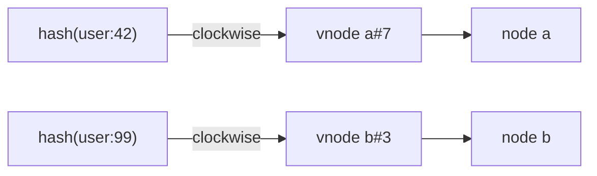
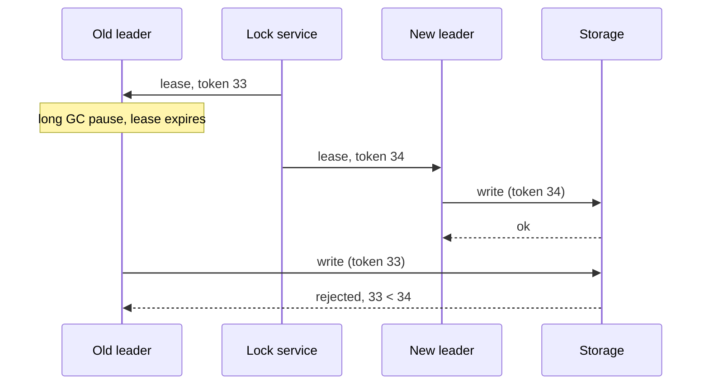

# Partitioning & Replication

Two orthogonal tools. **Partitioning** (sharding) splits data so each node holds a subset: it scales writes and storage. **Replication** keeps copies of the same data on several nodes: it buys availability, durability and read throughput. Real systems do both: each partition is replicated, and each node hosts replicas of many partitions.

## Partitioning

| | Hash partitioning | Range partitioning |
| --- | --- | --- |
| Placement | `hash(key)` picks the shard | sorted key ranges, one per shard |
| Load spread | even, as long as keys are | skewed if keys are monotonic (timestamps, auto-increment IDs) |
| Range scans | scatter to every shard | hit one or a few shards |
| Rebalancing | fixed partitions or consistent hashing | split / merge ranges |
| Examples | Cassandra, DynamoDB, Redis Cluster | HBase, Bigtable, Spanner, CockroachDB |

**Choosing a shard key.** Pick the key most queries filter on, so a request touches one shard; it should have high cardinality and a uniform access pattern. A compound key (`user_id`, then `created_at`) hashes the first part for placement and keeps the rest sorted within the partition, which gives cheap per-user range scans.

**Hot partitions.** Hashing spreads keys, not load: one celebrity key still lands on one shard. Fixes:

- **Key salting**: append a small random suffix (`key#0` … `key#9`) on write. Writes spread over 10 shards; reads must fan out to all 10 and merge. Only do it for keys known to be hot.
- Cache the hot reads in front of the store (see [Caching](./caching.md)).
- Split the hot range (range partitioning) or move the partition to a bigger node.

**Secondary indexes.** Partitioning by primary key leaves "find by color" with two options:

- **Local (document-partitioned)**: each shard indexes only its own rows. Writes stay single-shard; reads scatter-gather to every shard, and tail latency is the slowest shard.
- **Global (term-partitioned)**: the index is itself partitioned by the indexed value. Reads hit one index shard; a write touches the data shard plus one or more index shards, so the index is usually updated asynchronously and lags.

## Consistent hashing

`hash(key) % N` breaks when $N$ changes: a key stays put only if $h \bmod N = h \bmod (N+1)$, so about $N/(N+1)$ of all keys move. Going from 4 to 5 nodes moves ~80% of the data.

Consistent hashing places nodes and keys on the same ring $[0, 2^{32})$. A key belongs to the first node clockwise from its hash. Adding a node only steals keys from its clockwise neighbor, so about $1/N$ of keys move, all of them onto the new node.

With one point per node, arcs are wildly uneven and a departing node dumps its whole load on a single neighbor. **Virtual nodes** fix both: each physical node gets ~100–200 points on the ring, so arc sizes average out and a node's load scatters across many neighbors when it leaves. Vnode counts can also be weighted by node capacity.



```typescript
import { createHash } from "node:crypto";

// 32-bit position on the ring from the first 4 bytes of md5
const hash = (s: string): number =>
  createHash("md5").update(s).digest().readUInt32BE(0);

class Ring {
  // sorted vnode positions, with the owning node at the same index
  points: number[] = [];
  owners: string[] = [];

  constructor(nodes: string[], vnodes = 100) {
    const all: [number, string][] = [];
    for (const n of nodes)
      for (let i = 0; i < vnodes; i++) all.push([hash(`${n}#${i}`), n]);
    all.sort((a, b) => a[0] - b[0]);
    this.points = all.map(([p]) => p);
    this.owners = all.map(([, n]) => n);
  }

  // first vnode clockwise from hash(key), wrapping to index 0
  lookup(key: string): string {
    const h = hash(key);
    let lo = 0;
    let hi = this.points.length;
    while (lo < hi) {
      const mid = (lo + hi) >>> 1;
      if (this.points[mid] < h) lo = mid + 1;
      else hi = mid;
    }
    return this.owners[lo % this.points.length];
  }
}
```

Lookup is $O(\log(N \cdot V))$ for $V$ vnodes per node. Empirical check, 100k keys going from 4 to 5 nodes:

```typescript
const keys = Array.from({ length: 100_000 }, (_, i) => `user:${i}`);
const before = new Ring(["a", "b", "c", "d"]);
const after = new Ring(["a", "b", "c", "d", "e"]);
const ringMoved = keys.filter((k) => before.lookup(k) !== after.lookup(k)).length;
const modMoved = keys.filter((k) => hash(k) % 4 !== hash(k) % 5).length;
// ring: 0.20975, mod-N: 0.79729
console.log(`ring: ${ringMoved / keys.length}, mod-N: ${modMoved / keys.length}`);
```

The ring moves ~21% (ideal $1/5$), and every moved key lands on `e`; mod-N moves ~80%.

> [!TIP]
>
> If you were designing a distributed cache like Memcached, this is what the client libraries do: Ketama-style consistent hashing in the client, so adding a cache server invalidates ~$1/N$ of keys instead of nearly all of them.

## Rebalancing

- **Fixed partition count**: create many more partitions than nodes up front (e.g. 1000 partitions on 10 nodes). A new node steals whole partitions; keys never change partition, only partitions change node. Simple, but the count is hard to change later, so pick it for the largest expected cluster. Used by Riak, Elasticsearch, Couchbase, and Redis Cluster (16384 hash slots).
- **Dynamic splitting**: a partition splits in two when it exceeds a size threshold and merges when it shrinks; halves can move to other nodes. Partition count tracks data volume. Natural for range partitioning (HBase regions, Spanner splits); an empty database starts with one partition, so pre-split if you know the key distribution.

Keep a human in the loop for automatic rebalancing: a node that's slow, not dead, can trigger a rebalance that adds load to everything else and cascades.

## Replication

### Leader-follower

All writes go to the **leader**, which streams its change log to **followers**; reads can go to any replica.

- **Synchronous**: the leader waits for the follower's ack before confirming. The follower is guaranteed up to date, but one slow follower stalls all writes. In practice one follower is synchronous and the rest asynchronous ("semi-synchronous").
- **Asynchronous**: the leader confirms immediately. Fast, but a leader crash loses writes not yet shipped.

**Replication lag** on async followers produces visible anomalies: a user writes, then reads from a stale follower and their write is gone. Mitigations are read-your-writes (route a user's reads to the leader for a while after they write), monotonic reads (pin a user to one replica), and consistent-prefix reads. See [Consistency](./consistency.md) for the guarantees.

> [!TIP]
>
> If you were designing a social app's profile pages, this is the usual pattern: one primary handles writes, many read replicas absorb reads, and a user's own profile reads go to the primary right after an edit so they see their change.

### Multi-leader

Several leaders accept writes (typically one per datacenter) and replicate to each other asynchronously. Survives a datacenter outage and keeps writes local, but concurrent writes to the same key conflict:

- **Last-write-wins (LWW)**: keep the write with the highest timestamp; simple, silently drops the other writes, and trusts clocks.
- **CRDTs**: data types (counters, sets, sequences) whose merge is commutative, associative and idempotent, so replicas converge without coordination.

Offline-capable clients (calendars, collaborative editors) are multi-leader with each device as a leader.

### Leaderless (Dynamo-style)

Any replica accepts writes. The client (or a coordinator node) sends each write to all $N$ replicas of the key and each read to several, then reconciles versions. No failover step, because there is no leader. Used by Dynamo, Cassandra, Riak, ScyllaDB.

## Quorums

With $N$ replicas, a write succeeds after $W$ acks and a read queries $R$ replicas. If

$$
R + W > N
$$

every read set overlaps every write set in at least one replica, so a read sees the latest acknowledged write (by version). Common choice: $N = 3, W = 2, R = 2$. $W = N, R = 1$ favors reads; $W = 1, R = N$ favors writes. Quorums are not linearizable on their own: concurrent writes, partial failures, and LWW clock skew still leak stale reads.

- **Sloppy quorum**: when some of a key's home replicas are unreachable, accept writes on other healthy nodes so $W$ is still met. Higher write availability, but $R + W > N$ no longer guarantees overlap with the home replicas.
- **Hinted handoff**: the stand-in node stores the write with a hint naming the intended replica and forwards it once that replica is back.
- **Read repair**: a read that sees divergent versions writes the newest one back to the stale replicas. Rarely read keys rely on background **anti-entropy** (Merkle-tree comparison) instead.

> [!TIP]
>
> If you were designing a shopping cart like Amazon's (the original Dynamo paper), this is the trade: sloppy quorums and hinted handoff mean "add to cart" never fails, at the cost of occasionally merging divergent carts, where a deleted item can reappear.

## Failover pitfalls

Leader failover = detect failure (usually a heartbeat timeout), elect a new leader (the most up-to-date replica), and redirect clients and followers.

- **Timeout tuning**: too short and GC pauses or network blips trigger needless failovers; too long and writes are down for the duration.
- **Lost writes**: with async replication the new leader may lack the old leader's last writes. When the old leader returns, those writes are usually discarded, which breaks anything keyed off them (e.g. reused auto-increment IDs that other systems already saw).
- **Split brain**: the old leader was only partitioned, not dead, and keeps accepting writes alongside the new one. Electing via a majority (Raft, ZooKeeper, etcd) ensures at most one leader per term, but the old leader may not know it was deposed yet.

**Fencing tokens** close that last gap. The lock or lease service hands out a monotonically increasing token with every leadership grant; the leader attaches it to every write, and storage rejects any token lower than the highest it has seen. A deposed leader waking from a pause holds token 33 while storage has already seen 34, so its writes bounce.


