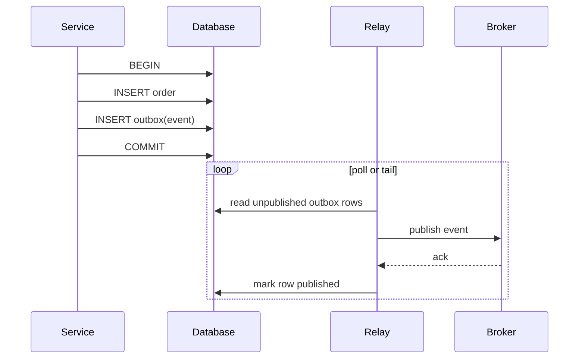

# Queues & Streams

Put a buffer between the thing that produces work and the thing that does it. The producer writes a message and moves on; consumers drain it at their own pace. You trade latency and simplicity for decoupling and resilience.

Why go async:

- **Decoupling**: the producer does not know who consumes, how many there are, or whether they are up right now. Consumers can be deployed, scaled, or broken independently.
- **Load smoothing**: a burst of 10k req/s into a queue drained at 2k/s becomes a backlog, not an outage. Size consumers for the average rate, not the peak.
- **Fan-out**: one event, many independent reactions (email, search index, analytics) without the producer calling each one.

The cost: the caller no longer gets a result synchronously, failures surface later and elsewhere, and "did it happen?" becomes a question of delivery semantics.

## Queue vs log

|                    | Queue (SQS, RabbitMQ)                                | Log (Kafka, Kinesis, Pulsar)                                       |
| ------------------ | ---------------------------------------------------- | ------------------------------------------------------------------ |
| On consume         | message is deleted when acked                        | message stays; consumer advances an offset                          |
| Retention          | until acked (or TTL)                                 | time/size based (days), or forever with compaction                 |
| Scaling consumers  | competing consumers: any consumer takes any message | consumer group: each partition owned by one consumer in the group  |
| Parallelism limit  | add consumers freely                                 | at most one active consumer per partition per group               |
| Ordering           | none (or per group in FIFO variants)                 | per partition                                                      |
| Replay             | no; once acked it is gone                            | yes; reset the offset                                              |
| Multiple readers   | needs one queue per subscriber (fan-out exchange/SNS) | any number of groups read the same log independently              |
| Per-message ack    | yes; individual retry and DLQ                        | no; offset commit is a high-water mark, one bad message blocks the partition |
| Good for           | task distribution, jobs, per-message retry           | event streams, multiple consumers, rebuilding state, analytics     |

Rule of thumb: if the message is a _command_ ("resize this image"), use a queue. If it is a _fact_ ("order 42 was placed") that several systems care about, use a log.

## Delivery semantics

- **At-most-once**: ack (or commit the offset) before processing. A crash mid-processing loses the message. Fine for metrics and logs.
- **At-least-once**: process, then ack. A crash after processing but before the ack redelivers. The default everywhere; duplicates are normal.
- **Effectively-once**: at-least-once delivery plus an idempotent consumer, so duplicates have no extra effect. Dedupe on a message ID or make the write naturally idempotent (upsert, conditional write). See [Consistency](./consistency.md) for idempotency keys.

True exactly-once _delivery_ over a network is not on offer. Kafka's "exactly-once semantics" (idempotent producer + transactions) covers read-process-write _within Kafka_; any external side effect (an email, a charge) still needs idempotency on your side.

## Ordering

Ordering is only guaranteed within a partition (or a FIFO message group). Across partitions, all bets are off. So the **partition key** decides what is ordered relative to what:

- Key by entity ID (`orderId`, `userId`) so all events for one entity land in one partition, in order.
- Too coarse a key (e.g. `tenantId` with one huge tenant) creates a hot partition, see [Partitioning & Replication](./partitioning-replication.md).
- No key (round-robin) gives the best spread and no ordering.
- Changing the partition count remaps keys: old events for a key sit in one partition, new ones in another. Over-provision partitions up front.

Retries break ordering too: if message 1 fails and is retried later while message 2 succeeds, the consumer saw 2 before 1. Either block the partition until 1 succeeds, or make the consumer tolerate reordering (version numbers, last-write-wins on a timestamp).

> [!TIP]
>
> If you were designing a ride-hailing app, driver location pings would go to a log keyed by driver ID: each driver's pings stay in order, while different drivers spread across partitions and consumers.

## Backpressure and failure handling

**Consumer lag** is the distance between the newest message and what consumers have processed (offsets behind head, or queue depth / age of oldest message). It is the primary health metric. Alert on age of oldest message, not raw depth; depth depends on traffic, age is what users feel.

**Backpressure** is how a slow consumer tells the producer to slow down. With a queue in the middle, the queue absorbs the difference until it cannot. Options when lag grows: scale consumers (up to the partition count for logs), batch more per fetch, shed or sample low-priority messages, or push back on producers (reject, `429`, see [Rate Limiting](./rate-limiting.md)).

**Visibility timeout** (SQS): a received message is hidden from other consumers for $T$ seconds. Ack (delete) within $T$ or it reappears and someone else processes it. Set $T$ above the worst-case processing time, or extend it with a heartbeat for long jobs; too short and you get duplicate work, too long and a crashed consumer delays the retry.

**Retries** need exponential backoff with jitter. Without jitter, every client that failed at the same moment retries at the same moment, and the retry wave knocks the dependency over again.

```ts
// "full jitter": sleep a uniform random time in [0, min(cap, base * 2^attempt)]
function backoff(attempt: number, baseMs = 100, capMs = 10_000): number {
  return Math.random() * Math.min(capMs, baseMs * 2 ** attempt);
}

async function withRetry<T>(fn: () => Promise<T>, maxAttempts = 5): Promise<T> {
  for (let attempt = 0; ; attempt++) {
    try {
      return await fn();
    } catch (err) {
      // out of attempts: surface the error so the message can go to the DLQ
      if (attempt + 1 >= maxAttempts) throw err;
      await new Promise((r) => setTimeout(r, backoff(attempt)));
    }
  }
}
```

Only retry transient errors (timeouts, `503`, throttling). A validation error will fail identically every time.

**Poison messages** are ones that will never succeed: malformed payload, a bug triggered by specific data. Retried forever, they burn capacity, and in a log they block the whole partition behind them. Cap attempts and move the message aside.

**Dead-letter queue (DLQ)**: after $N$ failed receives the broker (SQS redrive policy, RabbitMQ dead-letter exchange) or your consumer (Kafka has no built-in DLQ) moves the message to a separate queue. Alert on DLQ depth, inspect, fix, then redrive. A DLQ nobody watches is a slow-motion data loss.

## Transactional outbox

The dual-write problem: a service must update its database _and_ publish an event. Write DB then publish, and a crash in between loses the event. Publish then write, and a crash publishes an event for a change that never happened. There is no transaction spanning a database and a broker.

The fix: write the event into an `outbox` table **in the same DB transaction** as the business change. A separate relay reads the outbox and publishes.



The relay can crash between publish and mark, so it is at-least-once: consumers must dedupe on the event ID. Delete or archive published rows so the table stays small.

**CDC** (change data capture) is the sibling: tail the database's replication log (Postgres WAL, MySQL binlog) with a tool like Debezium and turn row changes into events, no polling or app-side outbox writes needed. Often the relay above _is_ CDC on the outbox table.

> [!TIP]
>
> If you were designing an e-commerce checkout, placing an order would insert the `orders` row and an `OrderPlaced` outbox row in one transaction; payment, inventory and email services then consume that event instead of being called inline.

## Fan-out patterns

- **Work queue** (point-to-point): N workers compete on one queue; each message is handled by exactly one worker. Scales throughput of a single job type.
- **Pub/sub**: each subscriber gets its own copy. With queues, a topic (SNS, RabbitMQ fanout exchange) copies into one queue per subscriber. With a log, each subscriber is its own consumer group on the same topic.
- **Combined**: pub/sub across services, work queue within each service (each consumer group has many members).

## Pitfalls

- **Unbounded queues hide outages.** A dead consumer looks like "the queue is a bit long" until it is days behind. Bound the queue or alert on age of oldest message, and decide up front what happens when it is full (block, drop, reject).
- **Large messages.** Brokers cap message size (Kafka defaults to about 1 MB; managed queues like SQS allow a few hundred KB up to about 1 MB) and big payloads hurt throughput everywhere. Put the blob in object storage and send a pointer (the "claim check" pattern).
- **Reprocessing after an offset reset.** Resetting a consumer group to earliest replays days of events: duplicate emails, double charges, overwritten newer state. Only replay into idempotent consumers, and know what `auto.offset.reset` does when committed offsets expire (`earliest` replays everything, `latest` silently skips).
- **Queue as a database.** No querying, no updates in place, retention limits. Keep the source of truth elsewhere; the log can be the source of truth only if you treat it as such (compaction, infinite retention, schema discipline).
- **Hidden synchronous coupling.** A request handler that publishes and then polls for the reply is RPC with extra steps and worse latency, see [Numbers](./numbers.md).
