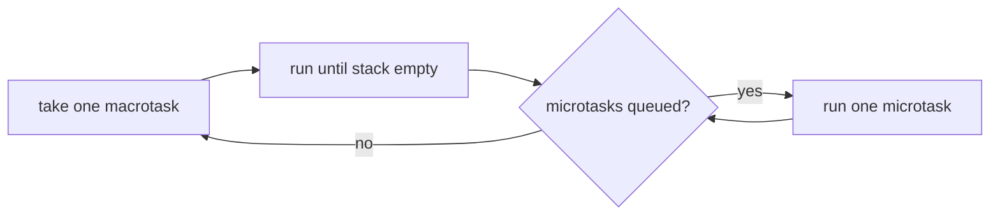

# Async & Timers

JavaScript runs your code on one thread. Concurrency comes from the event loop: run something to completion, then pick the next queued job. Nothing preempts a running function, so "async" means "later", not "in parallel".

## The Event Loop

Three pieces:

- **Call stack**: the synchronous code running now.
- **Macrotask queue**: timers, I/O callbacks, UI events, `MessageChannel` messages.
- **Microtask queue**: promise reactions (`then`/`catch`/`finally` callbacks, `await` continuations) and `queueMicrotask`.

One turn of the loop: run one macrotask until the stack is empty, then drain the **entire** microtask queue (including microtasks queued by microtasks), then (in a browser) maybe render, then take the next macrotask.



Guess the order:

```ts
console.log("1");
setTimeout(() => console.log("2"), 0);
Promise.resolve().then(() => console.log("3"));
queueMicrotask(() => console.log("4"));

async function f() {
  console.log("5");
  await null;
  console.log("6");
}
f();
console.log("7");
```

Answer: `1 5 7 3 4 6 2`. The sync code runs first (an async function's body runs synchronously up to its first `await`), then the microtasks in the order they were queued, then the timer.

> [!CAUTION]
>
> Because microtasks drain fully, a microtask that keeps queueing microtasks starves timers, I/O and rendering, just like an infinite loop does.

## Promise

A promise is a placeholder for a value that shows up later. It is in one of three states: **pending**, **fulfilled** (has a value) or **rejected** (has a reason). Once it is fulfilled or rejected (*settled*), it never changes again; calling `resolve`/`reject` after that does nothing.

```ts
const p = new Promise<number>((resolve, reject) => {
  // the executor runs synchronously, inside the constructor
  console.log("executor");
  setTimeout(() => resolve(42), 100);
});
// logged after "executor"
console.log("constructed");
```

If the executor throws, the promise is rejected with what was thrown.

Chaining: every `then`/`catch`/`finally` returns a **new** promise.

- `then(onFulfilled, onRejected)`: the new promise settles with whatever the callback returns, or rejects if the callback throws.
- If the callback returns a promise (or any *thenable*, i.e. an object with a `then` method), the new promise **adopts** it: it waits and takes on that promise's outcome. This is why chains flatten instead of nesting.
- `catch(fn)` is `then(undefined, fn)`. Returning a value from it recovers the chain.
- `finally(fn)` runs on both outcomes, gets no argument, and passes the original value or reason through. The exception: if `fn` throws or returns a rejected promise, that rejection replaces the outcome.

```ts
fetchUser(id)
  // returns a promise, which the chain adopts
  .then((user) => fetchPosts(user.id))
  .then((posts) => posts.length)
  // catches a rejection from any earlier step
  .catch(() => 0)
  .finally(() => hideSpinner());
```

Reactions always run as microtasks, even when the promise is already settled: `Promise.resolve(1).then(f)` never calls `f` synchronously.

## Combinators

| Combinator                | Fulfills when                       | Rejects when                                 | Empty input              |
| ------------------------- | ----------------------------------- | -------------------------------------------- | ------------------------ |
| `Promise.all(ps)`         | all fulfill, with values in order   | the first one rejects                        | fulfills with `[]`       |
| `Promise.allSettled(ps)`  | all settle, with `{status, value \| reason}[]` | never                             | fulfills with `[]`       |
| `Promise.race(ps)`        | the first to settle fulfills        | the first to settle rejects                  | stays pending forever    |
| `Promise.any(ps)`         | the first one fulfills              | all reject, with an `AggregateError`         | rejects (`AggregateError`) |
| `Promise.withResolvers()` | returns `{ promise, resolve, reject }`, so you can settle it from outside an executor | | |

None of them cancel the losers: after `all` rejects or `race` settles, the other operations keep running.

```ts
// same as new Promise + storing resolve/reject outside the executor
const { promise, resolve } = Promise.withResolvers<string>();
button.addEventListener("click", () => resolve("clicked"), { once: true });
await promise;
```

## async / await

An `async` function **always** returns a promise: `return x` fulfills it with `x`, `throw e` rejects it with `e`. `await p` suspends the function and returns control to the caller; when `p` settles, the rest of the function is resumed as a microtask. `await` on a value that is not a promise still yields once.

Sequential vs parallel:

```ts
// sequential: each fetch starts only after the previous one finished
for (const id of ids) {
  results.push(await fetchItem(id));
}

// parallel: start all of them, then wait for all of them
const results = await Promise.all(ids.map((id) => fetchItem(id)));
```

The loop version is correct when the steps depend on each other or you have to limit load; otherwise it is the classic slowdown. Note that `forEach(async ...)` is neither: it starts everything and waits for nothing.

Errors: a rejected `await` throws, so `try/catch` works. Inside a `try`, write `return await p` rather than `return p`, otherwise the rejection happens after the function has returned and the `catch` never sees it.

```ts
async function load(): Promise<Data | null> {
  try {
    // without await, the catch below would not catch a rejection of fetchData()
    return await fetchData();
  } catch {
    return null;
  }
}
```

**Floating promises**: a promise you neither `await`, `return` nor `.catch()`. Its errors go nowhere and its timing is not ordered with your code. If a rejection has no handler, it becomes an *unhandled rejection*: browsers fire an `unhandledrejection` event on `window`, and Node (since v15) crashes the process by default. Fire-and-forget on purpose should look like it:

```ts
void sendAnalytics(event).catch((err) => console.error(err));
```

> [!TIP]
>
> typescript-eslint's `no-floating-promises` and `no-misused-promises` rules catch most of these.

## Timers

```ts
const id = setTimeout(() => console.log("once"), 1000);
clearTimeout(id);

const iv = setInterval(() => console.log("tick"), 1000);
clearInterval(iv);
```

Delays are **minimums**, not guarantees. The callback is queued as a macrotask once the delay has passed, then waits for the stack and the microtasks to clear. Further delays:

- Browsers clamp delays to at least 4ms once timers are nested more than 5 levels deep (a timeout scheduling a timeout ...).
- Browsers throttle timers in background tabs, typically to at most once per second.

`setInterval` schedules on a fixed cadence, regardless of how long the callback takes. With async work in the callback, runs can **overlap** (the next tick starts before the previous request has finished), and a blocked thread makes ticks bunch up or get skipped. A self-scheduling `setTimeout` waits a full delay after each run finishes:

```ts
function every(ms: number, fn: () => Promise<void>): () => void {
  let id: ReturnType<typeof setTimeout>;
  let stopped = false;
  const tick = async () => {
    await fn();
    // schedule the next run only after this one finished
    if (!stopped) id = setTimeout(tick, ms);
  };
  id = setTimeout(tick, ms);
  return () => {
    stopped = true;
    clearTimeout(id);
  };
}
```

The `stopped` flag covers a stop that happens while `fn` is running, when there is no pending timer to clear.

The promise-based `sleep`:

```ts
const sleep = (ms: number) => new Promise<void>((resolve) => setTimeout(resolve, ms));

await sleep(500);
```

Return types differ: browsers return a `number`, Node returns a `Timeout` object (with `ref()`/`unref()`; an `unref`'d timer does not keep the process alive). For code that runs in both, type handles as `ReturnType<typeof setTimeout>` rather than `number` or `NodeJS.Timeout`.

## Timeouts & Cancellation

A timeout is a race against a timer. Clear the timer afterwards, or it keeps firing (and in Node keeps the process alive) after the real work has finished:

```ts
function withTimeout<T>(promise: Promise<T>, ms: number): Promise<T> {
  let id: ReturnType<typeof setTimeout>;
  const timeout = new Promise<never>((_, reject) => {
    id = setTimeout(() => reject(new Error(`timed out after ${ms}ms`)), ms);
  });
  return Promise.race([promise, timeout]).finally(() => clearTimeout(id));
}
```

This only stops **waiting**. A promise has no way to stop the work behind it; the request goes on and its result is thrown away. To actually stop work, the work has to listen for a cancellation signal: `AbortController` creates one, and APIs such as `fetch` accept it.

```ts
const controller = new AbortController();
const res = fetch(url, { signal: controller.signal });
// fetch rejects with an "AbortError" DOMException and the request is cancelled
controller.abort();
```

Ready-made signals:

```ts
// aborts by itself after 5s, with a "TimeoutError" DOMException
await fetch(url, { signal: AbortSignal.timeout(5000) });

// aborts as soon as any of the given signals aborts
const signal = AbortSignal.any([controller.signal, AbortSignal.timeout(5000)]);
```

Your own async functions should take a `signal` and respect it, both before starting and while waiting:

```ts
function sleep(ms: number, signal?: AbortSignal): Promise<void> {
  return new Promise((resolve, reject) => {
    // throwing inside the executor rejects the promise
    signal?.throwIfAborted();
    const id = setTimeout(resolve, ms);
    signal?.addEventListener(
      "abort",
      () => {
        clearTimeout(id);
        reject(signal.reason);
      },
      { once: true },
    );
  });
}
```

For long CPU-bound or multi-step work, check `signal.aborted` (or call `signal.throwIfAborted()`) between steps.

## Async Iteration

`for await (const x of source)` works on anything with a `[Symbol.asyncIterator]` method (async generators, Node streams, `ReadableStream` in recent runtimes), and also on plain iterables of promises, awaiting each in turn. An `async function*` can both `await` and `yield`:

```ts
async function* pages(url: string): AsyncGenerator<Item[]> {
  let next: string | null = url;
  while (next) {
    const res = await fetch(next);
    const body: { items: Item[]; next: string | null } = await res.json();
    yield body.items;
    next = body.next;
  }
}

for await (const items of pages("/api/items")) {
  render(items);
  // breaking out calls return() on the generator, so no more pages are fetched
  if (items.length === 0) break;
}
```

Iteration is pull-based and sequential: the generator does no work until the loop asks for the next value.
