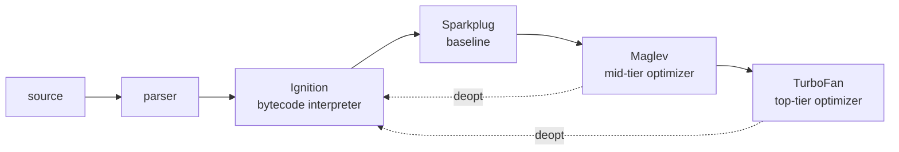

# Performance

TypeScript compiles to JavaScript; types are erased, so all runtime performance is the engine's. On Node and Chromium that engine is V8. The rule: **measure, find the hot path, then make that path boring for the JIT** — stable shapes, predictable types, few allocations. Everything outside the hot path should optimize for readability.

## Measure first

Coarse timing:

```ts
const t0 = performance.now();
work();
console.log(`${(performance.now() - t0).toFixed(2)} ms`);

// same thing, labelled
console.time("work");
work();
console.timeEnd("work");
```

Profiling:

- `node --cpu-prof app.js` writes a `.cpuprofile`; open it in Chrome DevTools (Performance panel) for a flame graph.
- `node --prof app.js` writes a V8 tick log; `node --prof-process isolate-*.log` summarizes it.
- `node --inspect app.js`, then attach DevTools from `chrome://inspect` for live CPU and heap profiling.
- Browser: DevTools Performance panel. Wide bars in the flame graph are where time goes; tall stacks alone mean nothing.

Microbenchmarks lie easily:

- **JIT warmup**: the first iterations run in the interpreter. Warm up before timing, or you measure the tiering, not the code.
- **Dead-code elimination**: if the result is unused, the optimizer may delete the work. Consume the result (accumulate it, return it).
- **GC noise**: a collection can land in any sample. Run many iterations and look at the distribution, not one number.
- **Unrealistic inputs**: a benchmark that only ever sees one shape is monomorphic; production code often is not.

Use a harness that handles warmup and statistics, e.g. [tinybench](https://github.com/tinylibs/tinybench) or [mitata](https://github.com/evanwashere/mitata):

```ts
import { Bench } from "tinybench";

const bench = new Bench({ time: 500 });
bench
  .add("for", () => {
    let s = 0;
    for (let i = 0; i < xs.length; i++) s += xs[i];
    return s;
  })
  .add("reduce", () => xs.reduce((a, b) => a + b, 0));
await bench.run();
console.table(bench.table());
```

## How V8 runs code



- **Ignition** interprets bytecode and collects type feedback (which shapes and types each operation saw).
- **Sparkplug** compiles bytecode to machine code quickly, without optimizing.
- **Maglev** and **TurboFan** compile hot functions speculatively using that feedback: "this `p.x` always sees shape S, so load at offset 8".
- **Deoptimization**: when a speculation fails (a new shape, a non-Smi where a Smi was expected), V8 throws away the optimized code and falls back to the interpreter. Repeated deopts are a common cause of mysterious slowness; `node --trace-deopt` lists them.

The practical upshot: code that sees the same types every time gets fast; code whose types vary keeps getting deoptimized or never gets specialized.

## Hidden classes and inline caches

V8 gives every object a hidden class (a "shape" or "map") describing its property layout. Objects that get the same properties **in the same order** share a shape. Each property access site has an **inline cache** (IC) remembering the shapes it has seen:

| IC state    | Shapes seen | Cost                                   |
| ----------- | ----------- | -------------------------------------- |
| monomorphic | 1           | fast: one check, then a fixed offset   |
| polymorphic | 2–4         | a few checks                           |
| megamorphic | more        | generic lookup, much slower in a loop  |

Keep shapes stable:

```ts
class Point {
  x: number;
  y: number;
  z: number;
  constructor(x: number, y: number) {
    // initialize every field, always in the same order
    this.x = x;
    this.y = y;
    // even if unknown yet: a placeholder beats adding it later
    this.z = 0;
  }
}

// bad: different insertion order means different shapes
const a = { x: 1, y: 2 };
const b = { y: 2, x: 1 };

// bad: adds a shape transition after construction
const p = new Point(1, 2);
(p as any).label = "origin";

// bad: delete often drops the object into slow dictionary mode
delete (p as any).z;
// instead, overwrite
p.z = 0;
```

TypeScript helps here: a class with declared fields and a constructor that sets them all is already the right pattern. Optional properties (`label?: string`) that are sometimes present produce two shapes; set them to `undefined` explicitly if the object is hot.

## Numbers and arrays

**Smis** (small integers, 31 or 32 bits depending on the build) are stored unboxed in the pointer. Anything else — fractions, large integers, `-0`, `NaN` — is a **heap number** (boxed), unless it lives in a double array or field V8 has specialized. Integer-only arithmetic in a hot loop stays cheap; `x | 0` was once a common hint but is rarely needed now.

Arrays carry an **elements kind**, roughly ordered from fastest to slowest:

```
PACKED_SMI -> PACKED_DOUBLE -> PACKED (any value)
    |              |               |
HOLEY_SMI  -> HOLEY_DOUBLE  -> HOLEY
```

Transitions only go **right/down**, never back. One `xs.push(1.5)` makes an int array a double array for good; one `xs.push("a")` makes it generic; one hole makes it holey (every read must then check the prototype chain).

```ts
// holey from birth: n empty slots
const a = new Array(n);

// packed: build by pushing
const b: number[] = [];
for (let i = 0; i < n; i++) b.push(0);

// best for numeric work: fixed-size, unboxed, no elements-kind games
const c = new Float64Array(n);
const d = new Int32Array(n);
```

Typed arrays are the default choice for numeric buffers (matrices, DP tables, pixel data): contiguous memory, no boxing, no holes, and transferable to workers. `new Array(n).fill(0)` is still holey in V8's eyes (it was created with holes); it is usually fine, but a typed array sidesteps the question.

`bigint` is arbitrary-precision and heap-allocated: every operation allocates. Use it for correctness (64-bit IDs, crypto), not speed. For 64-bit lanes in bulk, `BigInt64Array` avoids per-element objects but arithmetic still produces bigints.

## Allocation and GC

V8's GC is **generational**: new objects go into a small young generation collected by a fast scavenger; survivors are promoted to the old generation, collected by a (mostly concurrent) mark-compact. Short-lived garbage is cheap, but not free: in a hot loop it means frequent scavenges and pauses.

Common hidden allocations in hot loops:

```ts
for (const item of items) {
  // new closure each iteration
  const f = (x: number) => x * item.k;
  // new array each iteration
  const pair = [item.a, item.b];
  // spread copies the whole object
  const next = { ...state, count: state.count + 1 };
  // rest destructuring allocates a new object
  const { id, ...rest } = item;
}
```

Hoist closures, reuse scratch buffers, mutate in place when ownership is clear. V8's escape analysis removes some of these allocations in optimized code, so profile before rewriting.

**Object pooling** (reusing instances instead of allocating) adds bookkeeping and bugs (stale references, forgotten resets). Use it only when an allocation profile shows GC pressure from that type, typically in games or real-time rendering.

## Strings

- `a + b` on long strings often builds a **rope** (a lazy concatenation tree), so repeated `+=` is usually fine. The rope is flattened on first indexed access, which can show up as a surprise cost later.
- `parts.join("")` is the clear choice when building from a list; performance is comparable.
- Strings are immutable: `s.slice(i)` in a loop creates substrings. Parse with an index instead of repeatedly slicing the remainder.
- `s.charCodeAt(i)` returns a number; `s[i]` returns a one-char string. For tokenizers, compare char codes.

```ts
// scan digits without slicing or allocating substrings
function parseUint(s: string, i: number): [value: number, end: number] {
  let v = 0;
  for (; i < s.length; i++) {
    const c = s.charCodeAt(i);
    // '0'..'9' is 48..57
    if (c < 48 || c > 57) break;
    v = v * 10 + (c - 48);
  }
  return [v, i];
}
```

## Collections and loops

- **`Map`/`Set`** for dictionaries with dynamic keys, frequent insert/delete, or non-string keys. Plain objects used as dictionaries end up in dictionary mode anyway and inherit prototype keys (`"constructor"`, `"__proto__"`) unless created with `Object.create(null)`.
- **Plain objects** for records with a fixed set of known keys — that is what hidden classes optimize.
- **`for` vs `forEach`/`map`/`reduce`**: optimized V8 inlines the callbacks well, so for most code the difference is noise. In a measured hot path, a plain indexed `for` avoids the callback and the intermediate arrays of a `.filter().map().reduce()` chain. `for...of` on arrays is also well optimized.

## Async and the event loop

The event loop is single-threaded: any synchronous work longer than a few milliseconds delays every other callback, request, and frame.

```ts
// serial: total time = sum of latencies
for (const id of ids) results.push(await fetchOne(id));

// concurrent: total time ~ slowest latency
const results = await Promise.all(ids.map(fetchOne));
```

- Don't `await` inside a loop unless each step depends on the previous one. Unbounded `Promise.all` can overwhelm a server or the file-descriptor limit; batch into chunks of N.
- Each `await` costs a microtask turn. Wrapping a purely synchronous helper in `async` in a hot path adds overhead for nothing.
- CPU-bound work (hashing, parsing large files, image processing) belongs in `worker_threads` (Node) or Web Workers (browser). Pass `ArrayBuffer`s in the transfer list to move them instead of copying.

> [!CAUTION]
> Synchronous APIs (`fs.readFileSync`, `JSON.parse` on huge inputs, a catastrophic-backtracking regex) block the whole Node process. In a server that is a latency spike for every concurrent request.

## Checklist

| Area        | Do                                                       | Hot-path only? |
| ----------- | -------------------------------------------------------- | -------------- |
| Measurement | Profile before optimizing; benchmark with tinybench/mitata | no           |
| Shapes      | Init all fields in the constructor, same order; no `delete` | mostly       |
| ICs         | Keep call sites monomorphic; don't mix object types       | yes            |
| Numbers     | Typed arrays for numeric buffers; avoid `bigint` for speed | yes           |
| Arrays      | Avoid holes and mixed element types                       | yes            |
| Allocation  | No closures/spreads/temp arrays inside tight loops        | yes            |
| Pooling     | Only after an allocation profile says so                  | yes            |
| Strings     | Index + `charCodeAt` for parsing; no repeated `slice`     | yes            |
| Collections | `Map`/`Set` for dynamic keys; objects for fixed records   | no             |
| Loops       | Plain `for` in measured hot paths; chains elsewhere       | yes            |
| Async       | `Promise.all` independent work; batch; never block the loop | no           |
| CPU work    | Offload to workers; transfer buffers                      | no             |
